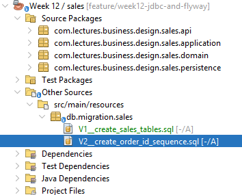
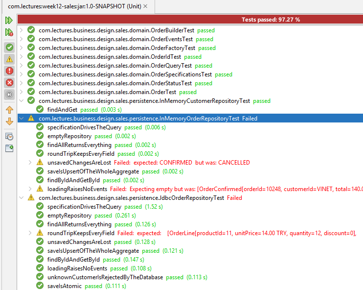
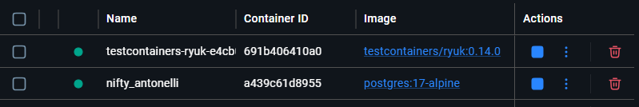
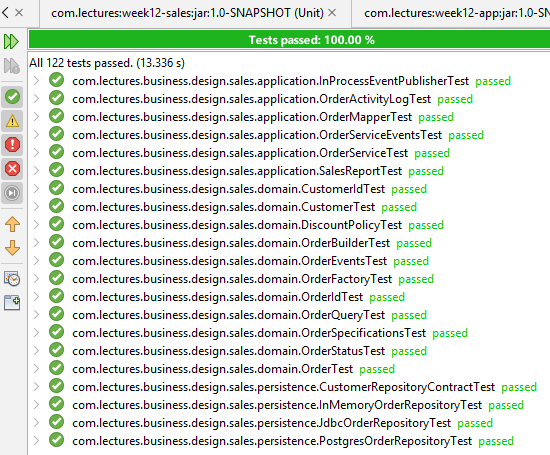
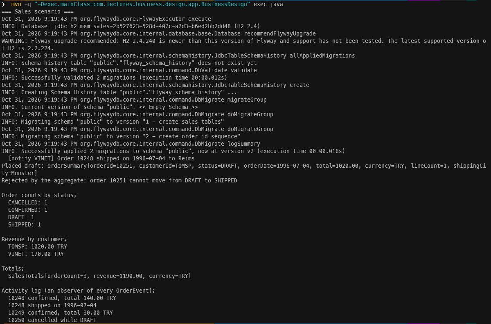
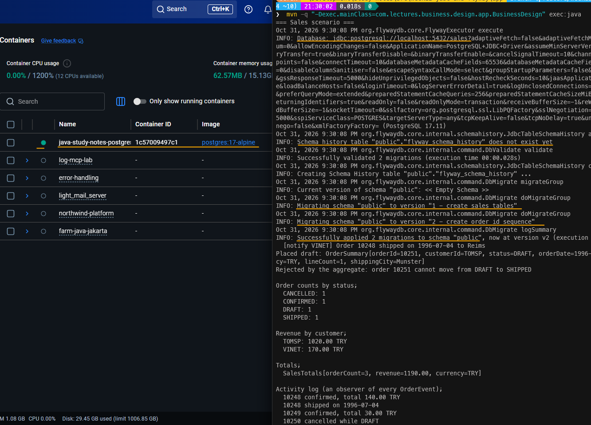
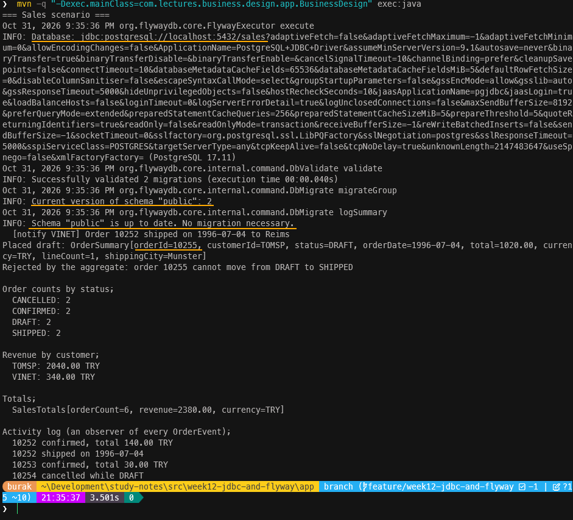
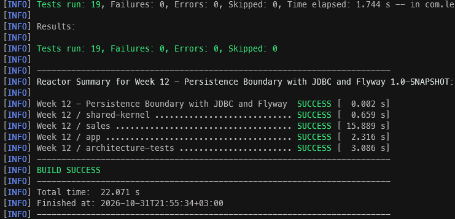
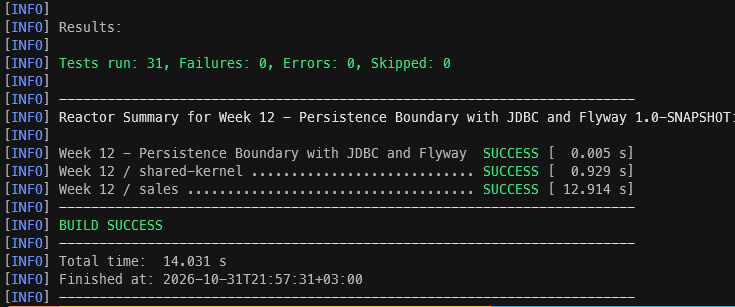
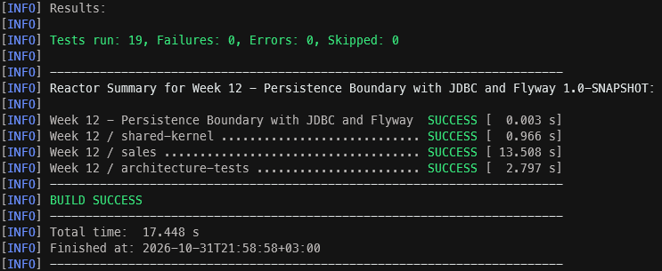

<a id="top"></a>

# Bölüm 12: Persistence Boundary, JDBC ve Flayway

<!-- nav:top:start -->
[← Bölüm 11](java-chapter-11.md#top) · [İçindekiler](README.md#top)
<!-- nav:top:end -->

Geldiğimiz nokta itibariyle epeyce ilerledik. Ancak şu ana kadarki tüm siparişler bellekte yönetildi *(in-memory)* ve kalıcı olarak saklanmıyor. Uygulamamız kapandığında veriler kayboluyor ve **SequentialOrderIdGenerator** her açılışta 10248 gibi sabit rakamdan saymaya başlıyor. Diğer yandan birde sorunumuz var; **InMemoryOrderRepository** sınıfı nesneleri referans yoluyla sakladığı için servis içinden yapılan **save** çağrısını silsek bile bütün testler geçecektir *(Bunu deneyelim)* Yani elimizdeki in-memory repository gerçek bir veritabanının en temel davranışlarından birini taklit etmiyor.

İşte bu bölümde repository sözleşmelerine dokunmadan, onların arkasına JDBC ile çalışan implementasyonlar yerleştireceğiz. Genelde bu gibi çözümlerde JPA *(Java Persistence API)* kullanılıyor ve kullanmayı tercih edeceğiz ancak bu bölümde bilinçli olarak daha alt seviyede, saf JDBC *(Java Database Connectivity)* ile çalışacağız. Amacımız JPA'nın bizim yerimize neleri yaptığını neleri kolaylaştırdığını fark edebilmek. Ağırlıklı olarak aşağıdaki sorulara cevap bulmaya çalışacağız.

- Bir aggregate ilişkisel tablolarla nasıl eşlenir? Aggregate ve transaction sınırları *(boundary)* arasında nasıl bir ilişki vardır?
- Veritabanından okunan bir siparişi, durum geçiş kurallarını tekrar çalıştırmadan ve olay üretmeden nasıl yeniden oluşturabiliriz?
- Veritabanı şemasını kim, nasıl ve hangi sırayla oluşturur? *(Flyway)*
- Aynı repository sözleşmesine uyan üç farklı implementasyonun gerçekten aynı şekilde davrandığından nasıl emin olabiliriz?

## Schema Kavramı ve Flyway Aracı

Genel bir felsefe olarak işe ilk önce tabloları tasarlayarak başlayacağız. **Northwind** veritabanındaki `Orders` ve `Order Details` tablolarını hatırlayalım. Bizim modelimizde de bir sipariş *(aggregate root)* ve ona ait sipariş kalemleri *(OrderLine)* yer alıyor. Bu yapıyı üç tablo ile ifade edebiliriz, sipariş veren müşteriler için `customers`,siparişler için `orders` ve sipariş kalemleri için `order_lines`. Kolon adlarını kobay **Northwind** veritabanımızdan, tipleriyse domain modellerinden alıyoruz.

Veritabanı şemasını elle oluşturmak yerine **Flyway** aracını kullanacağız. **Flyway**, veritabanı şemasını versiyonlanmış SQL script'leri ile yöneten bir araçt. Her betik *(script)* bir versiyon numarası taşır ve hangi betiğin hangi veritabanında çalıştırıldığı bilgisi de `flyway_schema_history` isimli tabloda tutulur. Uygulama açıldığında henüz çalıştırılmamış betikler sırasıyla çalıştırılır. Bunu `C#` tarafındaki Entity Framework Migrations ya da DbUp'a benzetebiliriz. Fark şu ki, EF Core migration'ları genellikle model sınıflarından üretilir *(Code First veya Model First yaklaşımını araştıralım)* Java tarafında yaygın olan kültürse SQL'in elle yazılması yönündedir. Başlangıçtaki SQL betiklerini db şemasının sahibi olan modülün kaynaklarına ekleyerek ilerleyelim. Yani sales modülündeki resources klasörüne aşağıdaki gibi ekleyeceğiz.

> Apache NetBeans IDE'sinde çalışıyorsak `Weel 12 / sales` modülünü açtıktan sonra modül adına sağ tıklayıp yeni Folder eklememiz gerekiyor. Folder adını `db/migration/sales`, Parent klasörünü ise `src/main/resources` olarak belirleyebiliriz. Bu işlem sonrasında proje ağacında `sales/src/main/resources/db/migration/sales` yolunu görmüş oluruz. İçerisine `Empty File` ekleyerek `V1__create_sales_tables.sql` ve `V2__create_order_id_sequence.sql` dosyalarını oluşturabiliriz.

```text
sales/src/main/resources/db/migration/sales/
├── V1__create_sales_tables.sql
└── V2__create_order_id_sequence.sql
```



Buradaki isimlendirmeler tesadüfi değildir. Dosya adındaki `V1__` öneki versiyonu, iki alt çizgiden sonraki kısım ise açıklamayı ifade eder. Path bilgisinde yer alan `sales` ifadesi bilinçli bir tercihtir. Birden fazla modül olduğunda her modülün kendi migration'larını kendi klasör sisteminde tutmasında yarar var. Bu sayede modüller bağımsız olarak evrilebilir ve migration'lar birbirini etkilemez.

```sql
CREATE TABLE customers (
    customer_id   CHAR(5)      NOT NULL,
    company_name  VARCHAR(40)  NOT NULL,
    contact_name  VARCHAR(30),
    street        VARCHAR(60)  NOT NULL,
    city          VARCHAR(15)  NOT NULL,
    postal_code   VARCHAR(10)  NOT NULL,
    country       VARCHAR(15)  NOT NULL,
    CONSTRAINT pk_customers PRIMARY KEY (customer_id)
);

CREATE TABLE order_statuses (
    status  VARCHAR(16) NOT NULL,
    CONSTRAINT pk_order_statuses PRIMARY KEY (status)
);

INSERT INTO order_statuses (status) VALUES ('DRAFT'), ('CONFIRMED'), ('SHIPPED'), ('CANCELLED');

CREATE TABLE orders (
    order_id          INTEGER      NOT NULL,
    customer_id       CHAR(5)      NOT NULL,
    order_date        DATE         NOT NULL,
    status            VARCHAR(16)  NOT NULL,
    ship_street       VARCHAR(60),
    ship_city         VARCHAR(15),
    ship_postal_code  VARCHAR(10),
    ship_country      VARCHAR(15),
    shipped_date      DATE,
    CONSTRAINT pk_orders PRIMARY KEY (order_id),
    CONSTRAINT fk_orders_customer FOREIGN KEY (customer_id) REFERENCES customers (customer_id),
    CONSTRAINT fk_orders_status FOREIGN KEY (status) REFERENCES order_statuses (status)
);

CREATE TABLE order_lines (
    order_id    INTEGER        NOT NULL,
    line_no     SMALLINT       NOT NULL,
    product_id  INTEGER        NOT NULL,
    unit_price  NUMERIC(10, 2) NOT NULL,
    currency    CHAR(3)        NOT NULL,
    quantity    SMALLINT       NOT NULL,
    discount    NUMERIC(3, 2)  NOT NULL,
    CONSTRAINT pk_order_lines PRIMARY KEY (order_id, product_id),
    CONSTRAINT fk_order_lines_order FOREIGN KEY (order_id) REFERENCES orders (order_id) ON DELETE CASCADE,
    CONSTRAINT ck_order_lines_quantity CHECK (quantity > 0),
    CONSTRAINT ck_order_lines_discount CHECK (discount BETWEEN 0 AND 1)
);
```

Buradaki şemada dikkat edilmesi gereken birkaç nokta var.

- **Teslimat adresi `orders` tablosunun içinde.** `Address` bir value object ve kendi kimliği yok. Bu yüzden ayrı bir tabloya değil doğrudan sahibinin satırına gömülüyor. Bunun JPA tarafındaki karşılığı ise `@Embedded` / `@Embeddable` ikilisi olacaktır.
- **`Money` iki kolona bölünüyor:** Tasarımımıza göre money nesnemiz `unit_price` ve `currency` bilgilerinden oluşuyor. Önceden `double` ile para tutmanın neden hatalı olduğu üzerinde durmuştuk. Veritabanında da aynı kural geçerlidir. `NUMERIC` alan kullanıyoruz, REAL ya da FLOAT değil *(Orijinal Northwind'de `Discount` kolonunun `REAL` olduğuna dikkat edelim)*.
- **`order_lines` tablosunun primary key alanı `(order_id, product_id)`.** Çünkü `Order.addLine` aynı ürün eklendiğinde yeni bir kalem açmak yerine mevcut kalemin miktarını artırıyor. Yani domain'deki bir kural veritabanı tarafında da bir kısıtlama *(constraint)* şeklinde korunuyor. `line_no` ise kalemlerin sırasını korumak için konulmuş bir alan.
- **Domain kuralları veritabanında ikinci kez korunuyor.** `quantity > 0` ve `discount BETWEEN 0 AND 1` kuralları zaten `OrderLine` record'unda var. Veritabanındaki kısıtlamalar *(constraints)* ise uygulamamız dışındaki bir istemcinin *(bir rapor aracı, elle çalıştırılan bir SQL)* hatalı veri yazmasını engellemek için. *(Bunun artı ve eksilerini tartışabiliriz)*

İkinci script dosyamız *(`V2__create_order_id_sequence.sql`)* ise sequence üretimini veritabanına tarafına taşıyor.

```sql
-- Order ids now come from the database: an in-process counter restarts at
-- 10248 on every boot and collides with the rows of the previous run.
CREATE SEQUENCE orders_seq START WITH 10248 INCREMENT BY 1;
```

> Flyway'in en önemli kuralı şu; **Uygulanmış bir migration dosyası asla değiştirilmez.** Flyway her script için bir checksum değeri saklar ve dosya değişmişse uygulama açılırken hata verir. Bir kolon eklemek istiyorsak `V1` dosyası üzerinde düzenleme yapmak yerine, `V3__add_freight_to_orders.sql` adında yeni bir script hazırlarız. Flyway'in güncel sürümleri ile birlikte PostgreSQL desteği ayrı bir modüle taşınmış olabilir. `flyway-core` bağımlılığının yanına `flyway-database-postgresql` bağımlılığı eklememiz gerekebilir. Bunu kontrol edelim.

## JDBC Tabanlı Order Repository Sınıfının Geliştirilmesi

Artık sipariş işlemlerinin veritabanı tarafındaki yönetimi için `persistence` paketine yeni bir repository sınıfı ekleyebiliriz. Bu sınıfın kodunu aşağıdaki gibi yazabiliriz. Biraz uzun olmakla birlikte en önemli kısımları üzerinde duracağız. Öncesinde ihtiyacımız olan bir Exception genişletmesini de ekleyelim. Özellikle `JdbcOrderRepository` sınıfında karşılaşabileceğimiz hataları temsil edecek bir exception sınıfı oluşturacağız.

```java
package com.lectures.business.design.sales.persistence;

public class RepositoryException extends RuntimeException {

    public RepositoryException(String message, Throwable cause) {
        super(message, cause);
    }
}
```

Şimdi `JdbcOrderRepository` sınıfını oluşturabiliriz. 

```java
package com.lectures.business.design.sales.persistence;

import com.lectures.business.design.sales.domain.CustomerId;
import com.lectures.business.design.sales.domain.Order;
import com.lectures.business.design.sales.domain.OrderId;
import com.lectures.business.design.sales.domain.OrderLine;
import com.lectures.business.design.sales.domain.OrderStatus;
import com.lectures.business.design.shared.kernel.Address;
import com.lectures.business.design.shared.kernel.Money;
import com.lectures.business.design.shared.kernel.Specification;
import java.sql.Connection;
import java.sql.PreparedStatement;
import java.sql.ResultSet;
import java.sql.SQLException;
import java.time.LocalDate;
import java.util.ArrayList;
import java.util.Currency;
import java.util.HashMap;
import java.util.List;
import java.util.Map;
import java.util.Objects;
import java.util.Optional;
import javax.sql.DataSource;

public final class JdbcOrderRepository implements OrderRepository {

    private static final String ORDER_COLUMNS = """
            order_id, customer_id, order_date, status,
            ship_street, ship_city, ship_postal_code, ship_country, shipped_date
            """;
    private static final String LINE_COLUMNS
            = "order_id, line_no, product_id, unit_price, currency, quantity, discount";

    private static final String UPDATE_ORDER = """
            UPDATE orders
               SET customer_id = ?, order_date = ?, status = ?,
                   ship_street = ?, ship_city = ?, ship_postal_code = ?, ship_country = ?,
                   shipped_date = ?
             WHERE order_id = ?
            """;
    private static final String INSERT_ORDER = """
            INSERT INTO orders (customer_id, order_date, status,
                                ship_street, ship_city, ship_postal_code, ship_country,
                                shipped_date, order_id)
            VALUES (?, ?, ?, ?, ?, ?, ?, ?, ?)
            """;
    private static final String DELETE_LINES = "DELETE FROM order_lines WHERE order_id = ?";
    private static final String INSERT_LINE
            = "INSERT INTO order_lines (" + LINE_COLUMNS + ") VALUES (?, ?, ?, ?, ?, ?, ?)";

    private final DataSource dataSource;

    public JdbcOrderRepository(DataSource dataSource) {
        this.dataSource = Objects.requireNonNull(dataSource, "dataSource must not be null");
    }

    @Override
    public void save(Order order) {
        Objects.requireNonNull(order, "order must not be null");
        try (Connection connection = dataSource.getConnection()) {
            connection.setAutoCommit(false);
            try {
                if (writeOrder(connection, UPDATE_ORDER, order) == 0) {
                    writeOrder(connection, INSERT_ORDER, order);
                }
                replaceLines(connection, order);
                connection.commit();
            } catch (SQLException | RuntimeException e) {
                connection.rollback();
                throw e;
            }
        } catch (SQLException e) {
            throw new RepositoryException("could not save order " + order.orderId(), e);
        }
    }

    @Override
    public Optional<Order> findById(OrderId orderId) {
        List<Order> found = query(" WHERE order_id = ?", orderId.value());
        return found.stream().findFirst();
    }

    @Override
    public List<Order> findAll() {
        return query("", null);
    }

    @Override
    public List<Order> findAll(Specification<Order> specification) {
        Objects.requireNonNull(specification, "specification must not be null");
        // Honest but expensive: every order is loaded, then filtered in memory.
        // Turning a Specification into a WHERE clause is what JPA Criteria does for us.
        return findAll().stream()
                .filter(specification::isSatisfiedBy)
                .toList();
    }

    @Override
    public long count() {
        try (Connection connection = dataSource.getConnection(); PreparedStatement statement = connection.prepareStatement("SELECT COUNT(*) FROM orders"); ResultSet rs = statement.executeQuery()) {
            rs.next();
            return rs.getLong(1);
        } catch (SQLException e) {
            throw new RepositoryException("could not count orders", e);
        }
    }

    // --- writing ---
    private static int writeOrder(Connection connection, String sql, Order order) throws SQLException {
        try (PreparedStatement statement = connection.prepareStatement(sql)) {
            Optional<Address> address = order.shippingAddress();
            statement.setString(1, order.customerId().value());
            statement.setObject(2, order.orderDate());
            statement.setString(3, order.status().name());
            statement.setString(4, address.map(Address::street).orElse(null));
            statement.setString(5, address.map(Address::city).orElse(null));
            statement.setString(6, address.map(Address::postalCode).orElse(null));
            statement.setString(7, address.map(Address::country).orElse(null));
            statement.setObject(8, order.shippedDate().orElse(null));
            statement.setInt(9, order.orderId().value());
            return statement.executeUpdate();
        }
    }

    private static void replaceLines(Connection connection, Order order) throws SQLException {
        try (PreparedStatement delete = connection.prepareStatement(DELETE_LINES)) {
            delete.setInt(1, order.orderId().value());
            delete.executeUpdate();
        }
        try (PreparedStatement insert = connection.prepareStatement(INSERT_LINE)) {
            int lineNo = 1;
            for (OrderLine line : order.lines()) {
                insert.setInt(1, order.orderId().value());
                insert.setInt(2, lineNo++);
                insert.setInt(3, line.productId());
                insert.setBigDecimal(4, line.unitPrice().amount());
                insert.setString(5, line.unitPrice().currency().getCurrencyCode());
                insert.setInt(6, line.quantity());
                insert.setBigDecimal(7, line.discount());
                insert.addBatch();
            }
            insert.executeBatch();
        }
    }

    private List<Order> query(String where, Integer orderId) {
        String orderSql = "SELECT " + ORDER_COLUMNS + " FROM orders" + where + " ORDER BY order_id";
        String lineSql = "SELECT " + LINE_COLUMNS + " FROM order_lines" + where + " ORDER BY order_id, line_no";

        try (Connection connection = dataSource.getConnection()) {
            Map<Integer, List<OrderLine>> lines = readLines(connection, lineSql, orderId);
            List<Order> orders = new ArrayList<>();
            try (PreparedStatement statement = connection.prepareStatement(orderSql)) {
                if (orderId != null) {
                    statement.setInt(1, orderId);
                }
                try (ResultSet rs = statement.executeQuery()) {
                    while (rs.next()) {
                        orders.add(toOrder(rs, lines.getOrDefault(rs.getInt("order_id"), List.of())));
                    }
                }
            }
            return List.copyOf(orders);
        } catch (SQLException e) {
            throw new RepositoryException("could not load orders", e);
        }
    }

    private static Map<Integer, List<OrderLine>> readLines(Connection connection, String sql, Integer orderId)
            throws SQLException {
        Map<Integer, List<OrderLine>> lines = new HashMap<>();
        try (PreparedStatement statement = connection.prepareStatement(sql)) {
            if (orderId != null) {
                statement.setInt(1, orderId);
            }
            try (ResultSet rs = statement.executeQuery()) {
                while (rs.next()) {
                    lines.computeIfAbsent(rs.getInt("order_id"), id -> new ArrayList<>())
                            .add(new OrderLine(
                                    rs.getInt("product_id"),
                                    new Money(rs.getBigDecimal("unit_price"),
                                            Currency.getInstance(rs.getString("currency"))),
                                    rs.getInt("quantity"),
                                    rs.getBigDecimal("discount")));
                }
            }
        }
        return lines;
    }

    private static Order toOrder(ResultSet rs, List<OrderLine> lines) throws SQLException {
        String street = rs.getString("ship_street");
        Address address = street == null ? null : new Address(street, rs.getString("ship_city"),
                rs.getString("ship_postal_code"), rs.getString("ship_country"));

        return Order.reconstitute(
                OrderId.of(rs.getInt("order_id")),
                CustomerId.of(rs.getString("customer_id")),
                rs.getObject("order_date", LocalDate.class),
                OrderStatus.valueOf(rs.getString("status")),
                address,
                rs.getObject("shipped_date", LocalDate.class),
                lines);
    }
}
```

Öncelikle bu sınıfın bir aggregate'i bütün olarak ele aldığını ifade ederek başlayalım. Yani, sipariş ve kalemleri hiçbir zaman birbirinden bağımsız olarak kaydedilmez ya da okunmaz. Repository'ye verdiğimiz ve ondan geri aldığımız şey her zaman eksiksiz bir `Order` nesnes örneğidir. `order_lines` tablosu için ayrı bir repository yazmamamızın sebebi de aslında bu. Kalemler siparişin bir parçasıdır ve kendi başlarına bir yaşam döngüleri yoktur, anlamlı değildir. Kod biraz uzun görünse de aslında birkaç temel karar üzerine kurulu. Bu kararları sırasıyla ele alarak devam edelim.

### Aggregate Sınırı = Transaction Sınırı

Sınıfın en önemli metodu `save` üzerinde duralım. Aşağıdaki kod parçasından ibaret.

```java
@Override
public void save(Order order) {
    Objects.requireNonNull(order, "order must not be null");
    try (Connection connection = dataSource.getConnection()) {
        connection.setAutoCommit(false);
        try {
            if (writeOrder(connection, UPDATE_ORDER, order) == 0) {
                writeOrder(connection, INSERT_ORDER, order);
            }
            replaceLines(connection, order);
            connection.commit();
        } catch (SQLException | RuntimeException e) {
            connection.rollback();
            throw e;
        }
    } catch (SQLException e) {
        throw new RepositoryException("could not save order " + order.orderId(), e);
    }
}
```

Aggregate'leri *tutarlılığın sınırı (boundary of consistency)* olarak düşünmek gerekiyor. Bir siparişin `orders` tablosuna yazıldığını ama kalemlerinin `order_lines` tablosuna yazılamadığını düşünelim. Veritabanında kalemleri eksik yarım kalmış bir sipariş oluşur ve domain modelimiz böyle bir durumu asla kabul etmez. Bu yüzden sipariş satırını ve tüm kalemleri tek bir transaction içerisinde yazıyoruz. `setAutoCommit(false)` çağrısı ile transaction'ı başlatıyor ve her şey yolunda giderse **commit**, bir hata oluşursa **rollback** çağrılarını icra ediyoruz.

İçteki catch bloğunun sadece **SQLException** değil **RuntimeException** türünü de yakaladığına dikkat edelim. Örneğin kalemlerden birini yazarken beklenmedik bir `NullPointerException` oluşursa, o ana kadar yazılmış olan sipariş satırının da geri alınması gerekir.

Peki ya **rollback** metodunu çağırmasak ne olur? `try-with-resources` bloğu bağlantıyı zaten kapatıyor. Ancak JDBC spesifikasyonu, açık bir transaction varken `close` çağrıldığında ne olacağını driver tarafına bırakmakta *(implementation-defined konusunu araştıralım)*. Bir veritabanı sürücüsü işi geri alabilir, bir diğeri commit edebilir. Bağlantı havuzu *(connection pool)* kullanıyorsak bağlantı aslında kapanmaz, havuza geri döner. Dolayısıyla bu kararı sürücüye bırakmak yerine açıkça kendimiz veriyoruz. JDBC ile çalışırken bu güvenceleri de düşünmek ve gerekiyorsa hazırlamak zorundayız.

> `save` metodundaki `setAutoCommit(false)`, `commit` ve `rollback` satırlarını yorum satırına alıp projedeki testleri çalıştırmayı deneyelim. Kuvvetle muhtemel hiçbir test patlamayacaktır. Çünkü henüz hiçbir test, kalemlerin yazılamadığı bir durumu denemiyor. Bu açığı sözleşme testlerinde ele alıp kapatacağız.

### Önce Güncelle, Olmazsa Ekle *(Update-Then-Insert)*

Dikkat edileceği üzere **OrderRepository** arayüzünde **insert** ve **update** isimli iki ayrı metot yerine sadece **save** tanımı var. Bu kararı In-Memory implementasyonda pek düşünmedik desek yeridir. Zira bir **Map** veri yapısı için ekleme ile güncelleme arasında bir fark yoktur. Ancak veritabanında tarafında ekleme ve güncelleme farklı işlemlerdir. Biz de önce **UPDATE** sorgusunu çalıştırıyoruz. `executeUpdate` metodu etkilenen satır sayısını döndürür. Bu değer sıfırsa sipariş veritabanında henüz yok demektir ve **INSERT** sorgusunu çalıştırırız.

Burada küçük bir de hile var. `INSERT_ORDER` sorgusundaki kolon sırasına dikkat edelim, `order_id` en sonda yer alıyor. `UPDATE_ORDER` sorgusunda da `order_id` değeri `WHERE` ifadesindeki dokuzuncu parametre olarak kullanılıyor. Buna göre `writeOrder` metodu her iki sorgunun parametrelerini aynı sırayla bağlayabilir. Tek bir metot iki farklı sorguya hizmet eder. Kolon sırasını değiştirdiğimiz andaysa bu metot çaktırmadan yanlış kolonlara yanlış değerler yazmaya başlar. Dolayısıyla bu bağımlılığın farkında olmamız önemlidir.

Aynı işi tek sorguda yapmanın yolları da var. PostgreSQL'in `INSERT ... ON CONFLICT (order_id) DO UPDATE` söz dizimi ya da standart SQL'deki `MERGE` ifadesi bunlardan ikisi. Ancak bu ifadelerin söz dizimi ve davranışı veritabanından veritabanına farklılık gösterebilir. Bizim kodumuz hem **H2** hem de **PostgreSQL** gibi ortamlar üzerinde çalışacak şekilde düşünelim. Bu nedenle her iki veritabanında da aynı şekilde davranan basit yöntemleri tercih etmek yerinde bir karar.

Tabii bu yöntemin iki zayıf noktası var. Şimdilik çözmeyeceğiz ama bilmek yarar var.

- **Yarış durumu *(race condition)*:** Aynı yeni siparişi iki istek aynı anda kaydetmeye çalışırsa ikisinin `UPDATE` sorgusu da sıfır satır etkiler ve ikisi de `INSERT` yapmaya çalışır. Birincil anahtar kısıtı sayesinde veri bozulmaz ama ikinci istek bir `RepositoryException` alır.
- **Kayıp güncelleme *(lost update)*:** İki kullanıcı aynı siparişi okuyup farklı değişiklikler yaparsa, son kaydeden ilkinin değişikliğini fark etmeden ezer. JPA bu sorunu `@Version` alanı ile, EF Core ise concurrency token *(örneğin `RowVersion`)* ile çözer. Bu yaklaşıma **optimistic locking** adı verilir.

> Bu durumlarla ilgili olarak veritabanı seviyesinde izolasyon seviyeleri ve kilitleme mekanizmaları da kullanılabilir. Ancak bu konular, uygulama kodundan bağımsız olarak veritabanının nasıl davrandığını belirler. Yine de araştırmakta yarar vardır.

### Sipariş Kalemleri Silinip Yeniden Yazılıyor

**replaceLines** metodu, hangi kalemin eklendiğini, hangisinin silindiğini ya da değiştiğini takip etmez. Siparişin tüm kalemlerini siler ve güncel listeyi yeniden yazar. Bir siparişin en fazla 50 kalemi olabildiğini belirlediğimiz için *(MAX_LINES sabiti)* bu yöntem oldukça pratik. Kalemleri yazarken **addBatch** ve **executeBatch** metotları kullanılıyor. Bu sayede elli kalem için veritabanına elli ayrı istek göndermek yerine toplu olarak göndermelerine izin veriyoruz. JPA ise **dirty checking** adı verilen bir mekanizma ile sadece değişen satırları yazabiliyor. Bunun için yüklediği her nesnenin bir kopyasını saklar ve transaction sonunda karşılaştırma yapar.

Tablo tasarımında `order_lines` için birincil anahtarın `(order_id, product_id)` ikilisi olduğunu hatırlayalım. Bu tesadüfi bir karar değil. `Order.addLine` metodu aynı ürün ikinci kez eklendiğinde yeni bir kalem açmak yerine mevcut kalemin miktarını artırıyor *(indexOfProduct)*. `line_no` kolonu ise kimlik değil, sadece sıra bilgisi taşıyor. Okuma sırasında `ORDER BY order_id, line_no` kullanıldığı için sipariş kalemleri veritabanından kaydedildikleri sırayla geri geliyor. Kalemler her kayıtta yeniden yazıldığı için `line_no` değerleri de her zaman 1'den başlayıp kesintisiz devam ediyor.

### Kullanılan Exception'lar Hakkında

**SQLException** checked türünden bir exception. Onu doğrudan fırlatsaydık **OrderRepository** arayüzündeki metot imzalarına `throws SQLException` ifadesinin de eklenmesi gerekirdi. Bu durumda JDBC alt yapsına ait bir detay sözleşmenin parçası haline gelir ve **InMemoryOrderRepository** hiç ihtiyacı olmadığı halde bu imzayı taşımak zorunda kalırdı. Bunun yerine **SQLException** nesnesini unchecked bir **RepositoryException** ile çevreliyoruz. Asıl hatayı **cause** olarak sakladığımız için hiçbir bilgi kaybolmuyor ve mesaja eklediğimiz sipariş numarası sayesinde log kayıtlarında hangi siparişin kaydedilemediğini de görebiliyoruz.

**RepositoryException** sınıfının **DomainException** sınıfından değil **RuntimeException** sınıfından türediğine de dikkat edelim. Veritabanı bağlantısının kopması bir iş kuralı ihlali değil tam tersi bir altyapı hatası. Kullanıcı isteğini düzelterek bu hatayı ortadan kaldıramayız. HTTP boundary konusunu incelediğimizde bu ayrımın neden önemli olduğunu göreceğiz.

## Veritabanından Yeniden Oluşturmak *(Reconstitution)*

Veritabanından okunan satırların tekrar bir **Order** nesnesine dönüştürülmesi gerekiyor. İlk akla gelen yöntem, siparişi oluşturup metotlarını sırasıyla çağırmak olabilir. Aynen aşağıdaki kod parçasında görüldüğü gibi.

```java
Order order = new Order(id, customerId, orderDate);
order.shipTo(address);
lines.forEach(line -> order.addLine(...));
order.confirm();
order.ship(shippedDate);
```

İlk bakışta normal görünse de birkaç sebepten dolayı hatalıdır.

- `confirm()` ve `ship()` metotları **OrderConfirmed**, **OrderShipped** olaylarını üretir. Siparişi her okuduğumuzda yeni olaylar oluşur ve müşteriye tekrar tekrar *"siparişiniz kargoya verildi"* bildirimleri gönderilir.
- İptal edilmiş bir siparişin hangi durumdan iptale çekildiğini bilemeyiz. Hangi metotları hangi sırayla çağıracağımıza karar verebilmek için durum geçişlerini tersine mühendislikle çözmemiz gerekir.
- Kurallar zamanla değişebilir büyük sistemlerde bu son derece yaygındır. Bugün bir siparişte en fazla elli kalem olabiliyorken yarın bu sınır otuz kaleme düşerse, geçmişte kırk kalemle kaydedilmiş bir sipariş artık hiç okunamaz.

Kayıtlı bir sipariş esasında yeni bir business işlem değildir. Kurallardan zaten bir kez geçmiş bir durumun geri yüklenmesidir. Bu nedenle **Order** sınıfına ayrı bir statik üretim metodu ekliyoruz.

```java
public static Order reconstitute(OrderId orderId, CustomerId customerId, LocalDate orderDate,
        OrderStatus status, Address shippingAddress, LocalDate shippedDate, List<OrderLine> lines) {
    Order order = new Order(orderId, customerId, orderDate);
    order.status = Objects.requireNonNull(status, "status must not be null");
    order.shippingAddress = shippingAddress;
    order.shippedDate = shippedDate;
    order.lines.addAll(Objects.requireNonNull(lines, "lines must not be null"));
    if ((status == OrderStatus.SHIPPED) != (shippedDate != null)) {
        throw new IllegalStateException(
                "stored order " + orderId + " is corrupt: status " + status + ", shipped " + shippedDate);
    }
    return order;
}
```

Metot statik olduğu ve **Order** sınıfının içinde yer aldığı için **private** alanlara doğrudan erişebilir. **pendingEvents** listesine dokunmadığı için de hiçbir olay üretmez. Durum geçiş kurallarını çalıştırmasa da tamamen savunmasız değildir. Kargolanmış bir siparişin bir kargo tarihi olmalıyken, kargolanmamış bir siparişin ise olmamalıdır. Bu tek kontrol, veritabanında bozulmuş bir satırı ilk okumada yakalamamızı sağlıyor. Dolayısıyla **DomainException** yerine **IllegalStateException** kullanmamızın sebebi de aynı. Bozuk bir kayıt kullanıcının ihlal ettiği bir iş kuralından ziyade sistemin kendi tutarsızlığının bir göstergesidir.

**toOrder** metodu da bu metodu kullanıyor. Kargo adresi için küçük bir karar daha veriyoruz. `ship_street` kolonu boşsa adresin hiç girilmediğini varsayıp **null** değer geçiyoruz. Adresin dört kolonu ya hep birlikte doludur ya da hep birlikte boştur.

Peki bu metodu kim çağırabilir? Metot **public** olduğu için derleyici herhangi bir paketin onu çağırmasını engellemez. Bir servis geliştiricisinin *"siparişin durumunu doğrudan SHIPPED yapayım"* niyetiyle **reconstitute** metodunu kullanması, aggregate'in koruduğu tüm kuralların atlanması anlamına gelir. Bu kuralı derleyici koruyamadığına göre **ArchUnit** ile koruma altına almak çok daha mantıklı olacaktır. Bunu ilerleyen kısımlarda tekrardan ele alacağız. Pek tabii bu tek seçenek değil. Diğer alternatifleri ve bedellerini şöyle özetleyebiliriz.

| **Yöntem** | **Nasıl çalışır?** | **Bedeli** |
| --- | --- | --- |
| Statik **reconstitute** metodu *(Tercih ettiğimiz yöntem)* | **Aggregate** kendi alanlarını doğrudan doldurur | **public** bir kapıdır ve sadece **ArchUnit** ile korunabilir |
| Package-private constructor | Repository'nin **aggregate** ile aynı pakette olmasını gerektirir | **domain** ve **persistence** paketlerini ayırdığımız yapımızla *(ADR-0003)* çelişir |
| Snapshot / Memento | **Aggregate** kendi durumunu bir record'a dönüştürür ve aynı record'dan geri yüklenir | Ek tipler gerektirir ama sınırı çok net çizer, event sourcing'e geçişi kolaylaştırır |
| Reflection *(JPA'nın yöntemi)* | Argümansız constructor ile nesneyi oluşturur, alanları reflection ile doldurur | **final** alanlar kullanılamaz ve **domain** sınıfına annotation'lar girer |

## Okuma: İki Sorgu ve N+1 Problemi

Siparişleri okurken hem **orders** hem de `order_lines` tablosuna gidilmesi gerekiyor. En basit yöntem önce siparişleri okumak, ardından her sipariş için kalemlerini ayrı bir sorgu ile getirmek gibi duruyor. Yüz sipariş için `1 + 100 = 101` sorgu çalışacağını düşünebiliriz. Bu durum **N+1 problemi** olarak da ifade edilir ve ORM *(Object Relational Mapping)* kullanan uygulamalardaki performans sorunlarının en yaygın sebeplerinden biridir. JPA çatısında `@OneToMany` ilişkisinin varsayılan olarak **LAZY** yüklenmesi ve bir döngü içinde `order.getLines()` çağrılması bunun klasik bir örneğidir.

**JdbcOrderRepository** ise sipariş sayısından bağımsız olarak her zaman iki sorgu çalıştırmakta. **query** metodu önce ilgili tüm kalemleri okuyup **readLines** içinde `order_id` değerine göre bir `Map` üzerinde gruplama yapıyor. Ardından siparişleri okurken her siparişin kalemlerini bu **Map** nesnesi üzerinden alıyor. Henüz hiç kalemi olmayan taslak bir sipariş için **getOrDefault** ile boş bir liste veriliyor. Sonuç olarak dönen liste `List.copyOf` ile değiştirilemez hale getiriliyor.

**where** parametresinin dışarıdan gelen bir değer değil de sınıf içindeki sabit bir metin olduğuna dikkat edelim. Kullanıcıdan gelebilecek her değer *(burada `orderId`)* `?` parametreleri ile bağlanıyor. **SQL injection** saldırılarına karşı temel kural bu. *(SQL metni asla kullanıcı girdisiyle birleştirilmez)* Bununla birlikte **query** metodunun **where** metni ile **orderId** parametresinin birbiriyle uyumlu olmasına güvendiğini de kabul edelim. Yeni filtreler eklemeye başladığımızda bu yaklaşım hızla kırılganlaşacaktır. Bu noktada küçük bir sorgu oluşturucu ya da jOOQ *(Java Object Oriented Querying)* gibi bir kütüphane devreye girer.

> İki sorgu aynı bağlantıyı kullanıyor ama bir transaction içinde çalışmıyor. Peki ya kalemleri okuduktan hemen sonra, siparişleri okumadan önce başka bir istek aynı siparişi güncellerse ne olur? Okunan sipariş ile kalemleri farklı anlara ait olabilir mi? Bunu tartışmaya açalım.

## Specification Sorguları: Dürüst ama Pahalı

Daha önceden hazırladığımız ve specification kalıbını ele aldığımız örneklerde aşağıdaki gibi oldukça basit bir yöntem kullanıyoruz.

```java
@Override
public List<Order> findAll(Specification<Order> specification) {
    Objects.requireNonNull(specification, "specification must not be null");
    return findAll().stream()
            .filter(specification::isSatisfiedBy)
            .toList();
}
```

`Specification<Order>` bir Java predicate'idir ve çok doğal olarak veritabanı tarafı onu anlayamaz. Bu nedenle tüm siparişleri belleğe yükleyip filtrelemeyi orada yapıyoruz. Doğru sonuç veriyor olsa da bir milyon siparişlik bir tabloda **VINET** müşterisinin siparişlerini bulmak için bir milyon siparişi belleğe yüklemek kabul edilebilir bir yaklaşım değil. Bu sorunu çözmenin yolu specification'ı bir **WHERE** ifadesine çevirebilmekle mümkün olur. JPA Criteria API ve Spring Data'daki `Specification<T>` arayüzü tam olarak bu işi yapar.

> C# tarafında bu problem çok daha zarif bir şekilde çözülür. `Expression<Func<Order, bool>>` tipindeki bir lambda, derleyici tarafından bir ifade ağacına *(expression tree)* dönüştürülür. EF Core bu ağacı çalışma zamanında inceleyip SQL ifadesine çevirebilir, `IQueryable<T>` de bu mekanizmanın üzerine kuruludur. Java'da ise lambda'lar çalışma zamanında bir ifade ağacı olarak incelenemez. Bu nedenle aynı çeviriyi bir API üzerinden *(Criteria, QueryDSL, jOOQ)* yapmak gerekir.

## Küçük Ama Önemli Bazı Detaylar

Sınıfın geri kalanında ilk bakışta gözden kaçabilecek ama üzerinde durmaya değer birkaç detay daha var. Bunları aşağıdaki gibi sıralayabiliriz;

- **DataSource constructor üzerinden geliyor:** Repository bağlantıyı **DriverManager** nesnesi ile kendisi açmaz. Hangi veritabanına, hangi bağlantı havuzu ile bağlanılacağına composition root nesnesi karar verecek. Testlerde H2, gerçek ortamda PostgreSQL kullanmamızı sağlayan şey de tam olarak bu.
- **`try-with-resources`:** **Connection**, **PreparedStatement** ve **ResultSet** nesneleri açıldıkları sıranın tersine otomatik olarak kapatılıyorlar. Bağlantı sızıntısı *(connection leak)* oluşmasını engellemiş oluyor.
- **Para değerleri:** `unit_price` kolonunu `NUMERIC(10, 2)` olarak tanımlamış ve **getBigDecimal** ile okuyoruz. Para birimini de ayrı bir **currency** kolonunda saklayıp **Money** nesnesini yeniden oluşturuyoruz. Önceden **double** kullanmama kararını verirken korumaya çalıştığımız hassasiyet veritabanında da korunmaya devam ediyor.
- **SQL için text block'lar:** Çok satırlı sorguları Java 15 ile gelen text block'lar *(`"""`)* ile yazdık. Okunabilirlik açısından epey avantajlı.

Böylece repository sözleşmesinin arkasına ikinci bir implementasyon yerleştirmiş olduk. Peki **JdbcOrderRepository** sınıfının gerçekten **InMemoryOrderRepository** ile aynı şekilde davrandığından nasıl emin olacağız? Hatırlarsak **save** çağrısını silsek bile testlerin geçtiğinden bahsetmişti. Bir sonraki adımda her iki implementasyona karşı aynı testleri çalıştıran sözleşme testlerini *(contract tests)* yazacağız.

## Müşteriler İçin JDBC Repository

Sözleşme testlerine geçmeden önce eksik bir parçayı tamamlayalım. **orders** tablosundaki `customer_id` kolonu **customers** tablosuna **foreign key** ile bağlı. Dolayısıyla veritabanına bir sipariş yazabilmek için önce o siparişin müşterisinin veritabanında da bulunması gerekiyor. Bu nedenle **CustomerRepository** sözleşmesinin bir de JDBC implementasyonuna ihtiyacımız var. **persistence** paketine aşağıdaki sınıfı ekleyerek devam edelim.

```java
package com.lectures.business.design.sales.persistence;

import com.lectures.business.design.sales.domain.Customer;
import com.lectures.business.design.sales.domain.CustomerId;
import com.lectures.business.design.shared.kernel.Address;
import java.sql.Connection;
import java.sql.PreparedStatement;
import java.sql.ResultSet;
import java.sql.SQLException;
import java.util.Objects;
import java.util.Optional;
import javax.sql.DataSource;

public final class JdbcCustomerRepository implements CustomerRepository {

    private static final String UPDATE_CUSTOMER = """
            UPDATE customers
               SET company_name = ?, contact_name = ?, street = ?, city = ?, postal_code = ?, country = ?
             WHERE customer_id = ?
            """;
    private static final String INSERT_CUSTOMER = """
            INSERT INTO customers (company_name, contact_name, street, city, postal_code, country, customer_id)
            VALUES (?, ?, ?, ?, ?, ?, ?)
            """;
    private static final String SELECT_CUSTOMER = """
            SELECT customer_id, company_name, contact_name, street, city, postal_code, country
              FROM customers
             WHERE customer_id = ?
            """;

    private final DataSource dataSource;

    public JdbcCustomerRepository(DataSource dataSource) {
        this.dataSource = Objects.requireNonNull(dataSource, "dataSource must not be null");
    }

    @Override
    public void save(Customer customer) {
        Objects.requireNonNull(customer, "customer must not be null");
        try (Connection connection = dataSource.getConnection()) {
            if (writeCustomer(connection, UPDATE_CUSTOMER, customer) == 0) {
                writeCustomer(connection, INSERT_CUSTOMER, customer);
            }
        } catch (SQLException e) {
            throw new RepositoryException("could not save customer " + customer.customerId(), e);
        }
    }

    @Override
    public Optional<Customer> findById(CustomerId customerId) {
        Objects.requireNonNull(customerId, "customerId must not be null");
        try (Connection connection = dataSource.getConnection(); PreparedStatement statement = connection.prepareStatement(SELECT_CUSTOMER)) {
            statement.setString(1, customerId.value());
            try (ResultSet rs = statement.executeQuery()) {
                return rs.next() ? Optional.of(toCustomer(rs)) : Optional.empty();
            }
        } catch (SQLException e) {
            throw new RepositoryException("could not load customer " + customerId, e);
        }
    }

    private static int writeCustomer(Connection connection, String sql, Customer customer) throws SQLException {
        try (PreparedStatement statement = connection.prepareStatement(sql)) {
            Address address = customer.address();
            statement.setString(1, customer.companyName());
            statement.setString(2, customer.contactName().orElse(null));
            statement.setString(3, address.street());
            statement.setString(4, address.city());
            statement.setString(5, address.postalCode());
            statement.setString(6, address.country());
            statement.setString(7, customer.customerId().value());
            return statement.executeUpdate();
        }
    }

    private static Customer toCustomer(ResultSet rs) throws SQLException {
        Customer customer = new Customer(
                CustomerId.of(rs.getString("customer_id")),
                rs.getString("company_name"),
                new Address(rs.getString("street"), rs.getString("city"),
                        rs.getString("postal_code"), rs.getString("country")));
        String contact = rs.getString("contact_name");
        if (contact != null) {
            customer.assignContact(contact);
        }
        return customer;
    }
}
```

Bu sınıf, **JdbcOrderRepository** için ele aldığıız kararların daha sade bir uyarlaması. Yine ilk olarak **UPDATE** deneniyor, etkilenen satır yoksa **INSERT** çalıştırılıyor. Yine `customer_id` kolonu her iki sorguda da son parametre olduğu için tek bir `writeCustomer` metodu iki sorguya da hizmet edebiliyor. Farklı olan tek nokta transaction yönetiminin olmaması. Bir müşteri tek bir satırdan oluşuyor ve tek satırlık bir yazma işlemi zaten atomik gerçekleşir. Bu nedenle bağlantının varsayılan **auto-commit** davranışı yeterlidir. `contact_name` kolonu boş olabildiği için müşteriyi önce zorunlu alanlarla oluşturup iletişim bilgisini sonradan atıyoruz.

## Test Ortamının Hazırlanması

Repository'lerimizi test edebilmek için bir veritabanına ihtiyacımız var. Testlerde tamamen bellekte çalışan **H2** veritabanını **PostgreSQL** uyumluluk modunda ele alabiliriz. Gerçek bir **PostgreSQL** üzerinde çalışmak içinse **Testcontainers** kütüphanesinden yararlanacağız. Önce `week12-jdbc-and-flyway` modülünün ana `pom.xml` dosyasına sürüm bilgilerini ve `dependencyManagement` girdilerini aşağıdaki gibi ekleyelim.

Driver bilgileri şöyle olmalı;

```xml
<properties>
    <archunit.version>1.5.1</archunit.version>
    <jar.plugin.version>3.4.2</jar.plugin.version>
    <flyway.version>10.20.1</flyway.version>
    <h2.version>2.4.240</h2.version>
    <postgresql.version>42.7.4</postgresql.version>
    <testcontainers.version>2.0.5</testcontainers.version>
    <slf4j.version>2.0.16</slf4j.version>
</properties>
```

Dependecy bilgilerine ekleneceklerse şöyle;

```xml
<dependency>
    <groupId>org.flywaydb</groupId>
    <artifactId>flyway-core</artifactId>
    <version>${flyway.version}</version>
</dependency>
<dependency>
    <groupId>org.flywaydb</groupId>
    <artifactId>flyway-database-postgresql</artifactId>
    <version>${flyway.version}</version>
</dependency>
<dependency>
    <groupId>com.h2database</groupId>
    <artifactId>h2</artifactId>
    <version>${h2.version}</version>
</dependency>
<dependency>
    <groupId>org.postgresql</groupId>
    <artifactId>postgresql</artifactId>
    <version>${postgresql.version}</version>
</dependency>
<dependency>
    <groupId>org.testcontainers</groupId>
    <artifactId>testcontainers-postgresql</artifactId>
    <version>${testcontainers.version}</version>
</dependency>
<dependency>
    <groupId>org.slf4j</groupId>
    <artifactId>slf4j-jdk14</artifactId>
    <version>${slf4j.version}</version>
</dependency>
```

Daha önceden de belirttiğimiz üzere **Flyway** güncel sürümlerinde **PostgreSQL** desteğini ayrı bir modül olarak sağlıyor. Bu nedenle `flyway-database-postgresql` bağımlılığını eklemezsek Flyway çatısı PostgreSQL veritabanını tanımayacaktır. **sales** modülünün `pom.xml` dosyasına bu bağımlılıkları **test** kapsamında *(scope)* aşağıdaki gibi ekleyelim.

```xml
<dependency>
    <groupId>org.flywaydb</groupId>
    <artifactId>flyway-core</artifactId>
    <scope>test</scope>
</dependency>
<dependency>
    <groupId>org.flywaydb</groupId>
    <artifactId>flyway-database-postgresql</artifactId>
    <scope>test</scope>
</dependency>
<dependency>
    <groupId>com.h2database</groupId>
    <artifactId>h2</artifactId>
    <scope>test</scope>
</dependency>
<dependency>
    <groupId>org.postgresql</groupId>
    <artifactId>postgresql</artifactId>
    <scope>test</scope>
</dependency>
<dependency>
    <groupId>org.testcontainers</groupId>
    <artifactId>testcontainers-postgresql</artifactId>
    <scope>test</scope>
</dependency>
<dependency>
    <groupId>org.slf4j</groupId>
    <artifactId>slf4j-jdk14</artifactId>
    <scope>test</scope>
</dependency>
```

Burada önemli bir detay var. **sales** modülünün asıl kodu *(main)* yalnızca JDK ile gelen `java.sql` ve `javax.sql` paketlerini kullanıyor. **Flyway**, **H2** ya da **PostgreSQL** sürücüsü hakkında hiçbir şey bilmiyor. Bu kütüphanelerin hepsi sadece testlerde kullanılıyor. Hangi veritabanının kullanılacağına ve migration'ların ne zaman çalıştırılacağına karar vermek **sales** modülünün değil composition root'un işi.

Testlerde her seferinde temiz bir veritabanı oluşturmak için küçük bir yardımcı sınıf işimizi epeyce kolaylaştıracaktır. Bu sınıfı **sales** modülünün test kodlarında, **persistence** paketine aşağıdaki gibi ekleyebiliriz.

```java
package com.lectures.business.design.sales.persistence;

import java.util.UUID;
import javax.sql.DataSource;
import org.flywaydb.core.Flyway;
import org.h2.jdbcx.JdbcDataSource;

public final class TestDatabases {

    private TestDatabases() {
    }

    public static DataSource h2() {
        JdbcDataSource dataSource = new JdbcDataSource();
        dataSource.setURL("jdbc:h2:mem:sales-" + UUID.randomUUID()
                + ";MODE=PostgreSQL;DATABASE_TO_LOWER=TRUE;DEFAULT_NULL_ORDERING=HIGH;DB_CLOSE_DELAY=-1");
        dataSource.setUser("sa");
        return migrate(dataSource);
    }

    public static DataSource migrate(DataSource dataSource) {
        Flyway.configure()
                .dataSource(dataSource)
                .locations("classpath:db/migration/sales")
                .load()
                .migrate();
        return dataSource;
    }
}
```

H2 bağlantı adresindeki parametrelerin her biri bilinçli olarak seçildi.

- **`mem:sales-<UUID>`:** Her çağrıda bellek üzerinde rastgele isimli bir veritabanı oluşturulur. Böylece testler birbirlerinin verilerini görmez.
- **`MODE=PostgreSQL`:** H2, PostgreSQL söz dizimini mümkün olduğunca taklit eder. `nextval('orders_seq')` gibi ifadeler bu sayede iki veritabanında da çalışır.
- **`DATABASE_TO_LOWER=TRUE`:** PostgreSQL tırnak içine alınmamış tablo ve kolon adlarını küçük harfe çevirir, H2 ise varsayılan olarak büyük harfe çevirir. Bu ayar iki veritabanını da aynı hizaya getirmeyi sağlar.
- **`DB_CLOSE_DELAY=-1`:** H2 normalde son bağlantı kapandığında bellekteki veritabanını siler. Repository'lerimiz her işlemde yeni bir bağlantı açıp kapattığı için bu ayar olmadan Flyway'in oluşturduğu tablolar ilk sorgudan önce hemen kaybolacaklardı.

## Sözleşme Testleri *(Contract Tests)*

Artık **OrderRepository** arayüzünün iki implementasyonu var. Emin olmamız gereken bir şey var ki o da, ikisinin de aynı davranışı sergilemesi. Her biri için ayrı test sınıfları yazarsak bu testler zamanla birbirinden farklılaşıp tutarsız hale gelebilir ve bir implementasyonun diğerinden farklı davrandığını fark etmeyebiliriz. Bunun yerine sözleşmeyi bir kez ve soyut bir test sınıfı olarak yazmak yerinde bir çözüm olacaktır. Bu amaçla aşağıdaki **OrderRepositoryContract** sınıfını yazarak devam edelim.

```java
package com.lectures.business.design.sales.persistence;

import com.lectures.business.design.sales.domain.CustomerId;
import com.lectures.business.design.sales.domain.Order;
import com.lectures.business.design.sales.domain.OrderBuilder;
import com.lectures.business.design.sales.domain.OrderId;
import com.lectures.business.design.sales.domain.OrderNotFoundException;
import com.lectures.business.design.sales.domain.OrderSpecifications;
import com.lectures.business.design.sales.domain.OrderStatus;
import com.lectures.business.design.shared.kernel.Address;
import com.lectures.business.design.shared.kernel.Money;
import java.math.BigDecimal;
import java.time.LocalDate;
import org.junit.jupiter.api.BeforeEach;
import org.junit.jupiter.api.DisplayName;
import org.junit.jupiter.api.Test;
import static org.assertj.core.api.Assertions.assertThat;
import static org.assertj.core.api.Assertions.assertThatThrownBy;

abstract class OrderRepositoryContract {

    protected OrderRepository repository;

    protected abstract OrderRepository createRepository();

    @BeforeEach
    void setUpContract() {
        repository = createRepository();
        repository.save(OrderBuilder.anOrder()
                .withId(10248).forCustomer("VINET").withLine(11, "14.00", 10).shipped().build());
        repository.save(OrderBuilder.anOrder()
                .withId(10249).forCustomer("VINET").withLine(11, "10.00", 3).confirmed().build());
        repository.save(OrderBuilder.anOrder()
                .withId(10250).forCustomer("TOMSP").withLine(11, "99.00", 5).cancelled().build());
        repository.save(OrderBuilder.anOrder()
                .withId(10251).forCustomer("TOMSP").withLine(11, "20.00", 4).build());
    }

    @Test
    @DisplayName("findById answers with an Optional, getById with an exception")
    void findByIdAndGetById() {
        assertThat(repository.findById(OrderId.of(10248))).isPresent();
        assertThat(repository.findById(OrderId.of(99999))).isEmpty();
        assertThatThrownBy(() -> repository.getById(OrderId.of(99999)))
                .isInstanceOf(OrderNotFoundException.class);
    }

    @Test
    @DisplayName("an aggregate comes back exactly as it was saved")
    void roundTripKeepsEveryField() {
        Order original = OrderBuilder.anOrder()
                .withId(10260).forCustomer("TOMSP").orderedOn(LocalDate.of(1996, 7, 19))
                .shippingTo(new Address("Luisenstr. 48", "Munster", "44087", "Germany"))
                .withLine(11, "14.00", 12)
                .withDiscountedLine(42, "9.80", 10, "0.1")
                .shipped().build();
        repository.save(original);

        Order loaded = repository.getById(OrderId.of(10260));

        assertThat(loaded.customerId()).isEqualTo(CustomerId.of("TOMSP"));
        assertThat(loaded.orderDate()).isEqualTo(LocalDate.of(1996, 7, 19));
        assertThat(loaded.status()).isEqualTo(OrderStatus.SHIPPED);
        assertThat(loaded.shippedDate()).isEqualTo(original.shippedDate());
        assertThat(loaded.shippingAddress()).isEqualTo(original.shippingAddress());
        assertThat(loaded.lines()).isEqualTo(original.lines());
        assertThat(loaded.total()).isEqualTo(original.total());
    }

    @Test
    @DisplayName("a change that is not saved is not stored")
    void unsavedChangesAreLost() {
        Order order = repository.getById(OrderId.of(10249));
        order.cancel();

        assertThat(repository.getById(OrderId.of(10249)).status()).isEqualTo(OrderStatus.CONFIRMED);

        repository.save(order);
        assertThat(repository.getById(OrderId.of(10249)).status()).isEqualTo(OrderStatus.CANCELLED);
    }

    @Test
    @DisplayName("save replaces by identity: lines that left the aggregate leave the store")
    void saveIsUpsertOfTheWholeAggregate() {
        Order draft = repository.getById(OrderId.of(10251));
        draft.addLine(42, Money.tl("9.80"), 1, BigDecimal.ZERO);
        draft.removeLine(11);
        repository.save(draft);

        assertThat(repository.count()).isEqualTo(4);
        assertThat(repository.getById(OrderId.of(10251)).productIds()).containsExactly(42);
    }

    @Test
    @DisplayName("a loaded aggregate announces nothing: reconstitution is not a business event")
    void loadingRaisesNoEvents() {
        assertThat(repository.getById(OrderId.of(10248)).pullEvents()).isEmpty();
    }

    @Test
    @DisplayName("findAll returns every aggregate as an unmodifiable list")
    void findAllReturnsEverything() {
        assertThat(repository.findAll())
                .isUnmodifiable()
                .extracting(order -> order.orderId().value())
                .containsExactlyInAnyOrder(10248, 10249, 10250, 10251);
    }

    @Test
    @DisplayName("specifications select and combine, ordered by id")
    void specificationDrivesTheQuery() {
        assertThat(repository.findAll(OrderSpecifications.placedBy(CustomerId.of("VINET"))))
                .extracting(order -> order.orderId().value())
                .containsExactly(10248, 10249);
        assertThat(repository.findAll(OrderSpecifications.placedBy(CustomerId.of("ALFKI")))).isEmpty();
        assertThat(repository.findAll(OrderSpecifications.notCancelled()
                .and(OrderSpecifications.placedBy(CustomerId.of("TOMSP")))))
                .extracting(order -> order.orderId().value())
                .containsExactly(10251);
    }

    @Test
    @DisplayName("an empty repository answers without blowing up")
    void emptyRepository() {
        OrderRepository empty = createRepository();
        assertThat(empty.count()).isZero();
        assertThat(empty.findAll()).isEmpty();
        assertThat(empty.findAll(OrderSpecifications.notCancelled())).isEmpty();
        assertThat(empty.findById(OrderId.of(10248))).isEmpty();
    }
}
```

Bu sınıfta dikkat etmemiz gereken birkaç nokta var.

- Sınıf **abstract** ve hangi implementasyonun test edileceğini bilmiyor. Bu kararı `createRepository` metodunu ezen *(override)* alt sınıflara bırakıyoruz.
- `@BeforeEach` anotasyonu ile işaretlenmiş metot her testten önce yeni ve boş bir repository oluşturup dört sipariş ekliyor. Her test aynı başlangıç durumundan yola çıkıyor.
- Önceki testlerimizden farklı olarak üç yeni davranışı da sözleşmeye ekledik. **roundTripKeepsEveryField** bir siparişin tüm alanlarıyla eksiksiz geri geldiğini, **unsavedChangesAreLost** kaydedilmeyen bir değişikliğin kalıcı olmadığını, **loadingRaisesNoEvents** ise okunan bir siparişin olay *(event)* üretmediğini doğruluyor.

Her implementasyon için yazmamız gereken tek şey, boş bir repository'nin nasıl oluşturulacağı. In-Memory versiyon için test sınıfımız aşağıdaki kadar kısa olacaktır.

```java
package com.lectures.business.design.sales.persistence;

class InMemoryOrderRepositoryTest extends OrderRepositoryContract {

    @Override
    protected OrderRepository createRepository() {
        return new InMemoryOrderRepository();
    }
}
```

**JDBC** versiyonunda ise biraz daha fazla iş var. Her test için yeni bir **H2** veritabanı oluşturuyor ve **foreign key** kısıtını karşılamak için iki müşteriyi önceden ekliyoruz. Bunun yanında sadece bir veritabanının yanlış yapabileceği iki davranışı da bu sınıf içerisinde test ediyoruz.

```java
package com.lectures.business.design.sales.persistence;

import java.sql.Connection;
import java.sql.SQLException;
import java.sql.Statement;

import javax.sql.DataSource;

import static org.assertj.core.api.Assertions.assertThat;
import static org.assertj.core.api.Assertions.assertThatThrownBy;
import org.junit.jupiter.api.DisplayName;
import org.junit.jupiter.api.Test;

import com.lectures.business.design.sales.domain.Customer;
import com.lectures.business.design.sales.domain.CustomerId;
import com.lectures.business.design.sales.domain.OrderBuilder;
import com.lectures.business.design.sales.domain.OrderId;
import com.lectures.business.design.shared.kernel.Address;

class JdbcOrderRepositoryTest extends OrderRepositoryContract {

    private DataSource dataSource;

    static void seedCustomers(DataSource dataSource) {
        CustomerRepository customers = new JdbcCustomerRepository(dataSource);
        customers.save(new Customer(CustomerId.of("VINET"), "Vins et alcools Chevalier",
                new Address("59 rue de l'Abbaye", "Reims", "51100", "France")));
        customers.save(new Customer(CustomerId.of("TOMSP"), "Toms Spezialitaten",
                new Address("Luisenstr. 48", "Munster", "44087", "Germany")));
    }

    @Override
    protected OrderRepository createRepository() {
        dataSource = TestDatabases.h2();
        seedCustomers(dataSource);
        return new JdbcOrderRepository(dataSource);
    }

    @Test
    @DisplayName("the foreign key refuses an order for a customer that does not exist")
    void unknownCustomerIsRejectedByTheDatabase() {
        assertThatThrownBy(() -> repository.save(OrderBuilder.anOrder()
                .withId(10300).forCustomer("ALFKI").withLine(11, "14.00", 1).build()))
                .isInstanceOf(RepositoryException.class)
                .hasRootCauseInstanceOf(SQLException.class);
    }

    @Test
    @DisplayName("a failed save leaves no half-written aggregate behind")
    void saveIsAtomic() throws SQLException {
        try (Connection connection = dataSource.getConnection(); Statement statement = connection.createStatement()) {
            statement.execute("ALTER TABLE order_lines ADD CONSTRAINT ck_sabotage CHECK (quantity <> 7)");
        }

        assertThatThrownBy(() -> repository.save(OrderBuilder.anOrder()
                .withId(10301).forCustomer("VINET").withLine(11, "14.00", 7).build()))
                .isInstanceOf(RepositoryException.class);
        assertThat(repository.findById(OrderId.of(10301))).isEmpty();
        assertThat(repository.count()).isEqualTo(4);
    }
}
```

**saveIsAtomic** testi transaction'ın gerçekten çalıştığını görebilmek için sipariş satırının yazılıp kalemlerin yazılamadığı bir durum oluşturmaya çalışıyor. Bunun için test içinde veritabanına küçük bir sabotaj kuralı eklendi. Miktarı 7 olan bir kalem artık `order_lines` tablosuna yazılamıyor ama **orders** tablosu bu kuraldan etkilenmiyor. **save** metodu önce sipariş satırını yazıyor ve ardından kalemleri yazmaya çalışırken hata alıyor. Sonrasıda **rollback** ile sipariş satırını da geri alıyor. `setAutoCommit(false)`, `commit` ve `rollback` satırlarını yorum satırına alıp testi tekrar çalıştırırsak bu kez sadece bu testin kırıldığını görmemiz lazım. Sipariş satırı veritabanında kalmıştır ama kalemleri yoktur.

## Sözleşme Testleri Üç Hata Yakaladı

Testleri ilk kez çalıştırdığımızda üç testin kırılması gerekiyor.



unsavedChangesAreLost, loadingRaisesNoEvents ve roundTripKeepsEveryField metotları patlamış olmalı. Şimdi bu durumları kısaca değerlendirmeye çalışalım.

### 1. In-Memory Repository Bir Veritabanı gibi Davranmıyor

İlk iki hata aynı sebepten kaynaklanıyor. Bölümün başında **InMemoryOrderRepository** sınıfının nesneleri referans yoluyla sakladığından ve servis içindeki **save** çağrısını silsek bile testlerin geçtiğinden bahsetmiştik. Sözleşme testi bu açığı sonunda yakaladı. **JDBC** implementasyonu bu testleri geçiyor ama **In-Memory** implementasyon geçemiyor zira **getById** ile alınan nesne, **map** içindeki nesnenin ta kendisi. Test siparişi iptal ettiğinde, repository'deki sipariş kaydedilmeden önce de iptal edilmiş olur. Benzer şekilde test verisini hazırlarken **OrderBuilder** ile oluşturduğumuz siparişlerin biriktirdiği olaylar da nesneyle birlikte **map** içerisinde durur ve okuyan herkese yeniden verilirler.

Çözüm olarak **In-Memory** repository'nin de bir veritabanı gibi davranmasını sağlamamız gerekiyor. Kaydederken bir kopyasını saklayacak, okurken ise her seferinde yeni bir kopya üretecek. Kopyayı oluştururken de **JDBC repository**'nin kullandığı kontrol noktasından yani **reconstitute** metodundan geçilecek. Böylece kopyaların event taşımaması da sağlanmış olacak. Buna göre **InMemoryOrderRepository** sınıfının güncel halinin aşağıdaki gibi olması gerekiyor.

```java
package com.lectures.business.design.sales.persistence;

import com.lectures.business.design.sales.domain.Order;
import com.lectures.business.design.sales.domain.OrderId;
import com.lectures.business.design.shared.kernel.Specification;
import java.util.Comparator;
import java.util.LinkedHashMap;
import java.util.List;
import java.util.Map;
import java.util.Objects;
import java.util.Optional;

public final class InMemoryOrderRepository implements OrderRepository {

    private final Map<OrderId, Order> orders = new LinkedHashMap<>();

    @Override
    public void save(Order order) {
        Objects.requireNonNull(order, "order must not be null");
        orders.put(order.orderId(), copyOf(order));
    }

    @Override
    public Optional<Order> findById(OrderId orderId) {
        return Optional.ofNullable(orders.get(orderId)).map(InMemoryOrderRepository::copyOf);
    }

    @Override
    public List<Order> findAll() {
        return orders.values().stream().map(InMemoryOrderRepository::copyOf).toList();
    }

    @Override
    public List<Order> findAll(Specification<Order> specification) {
        Objects.requireNonNull(specification, "specification must not be null");
        return orders.values().stream()
                .filter(specification::isSatisfiedBy)
                .sorted(Comparator.comparing(Order::orderId))
                .map(InMemoryOrderRepository::copyOf)
                .toList();
    }

    @Override
    public long count() {
        return orders.size();
    }

    private static Order copyOf(Order order) {
        return Order.reconstitute(order.orderId(), order.customerId(), order.orderDate(),
                order.status(), order.shippingAddress().orElse(null),
                order.shippedDate().orElse(null), order.lines());
    }
}
```

**copyOf** metodunun içeriğini bu anlamda dikkatlice değerlendirelim. Benzer sorun **InMemoryCustomerRepository** sınıfında da var. Onu da aynı şekilde düzenleyelim.

```java
package com.lectures.business.design.sales.persistence;

import com.lectures.business.design.sales.domain.Customer;
import com.lectures.business.design.sales.domain.CustomerId;
import java.util.HashMap;
import java.util.Map;
import java.util.Objects;
import java.util.Optional;

public final class InMemoryCustomerRepository implements CustomerRepository {

    private final Map<CustomerId, Customer> customers = new HashMap<>();

    @Override
    public void save(Customer customer) {
        Objects.requireNonNull(customer, "customer must not be null");
        customers.put(customer.customerId(), copyOf(customer));
    }

    @Override
    public Optional<Customer> findById(CustomerId customerId) {
        return Optional.ofNullable(customers.get(customerId)).map(InMemoryCustomerRepository::copyOf);
    }

    private static Customer copyOf(Customer customer) {
        Customer copy = new Customer(customer.customerId(), customer.companyName(), customer.address());
        customer.contactName().ifPresent(copy::assignContact);
        return copy;
    }
}
```

Bu değişikliklere göre in-memory test dublörümüz artık gerçek bir veritabanının en temel davranışını taklit ediyor diyebiliriz. Ancak emin olmak için gerekli testleri yaptığınızdan emin olun.

### 2. BigDecimal ve Ölçek *(Scale)* Problemi

**roundTripKeepsEveryField** testinin hatası ilk bakışta biraz tuhaf görünüyor. Hatanın stack trace içeriği aşağıdakine benzer.

```text
expected: 
  [OrderLine[productId=11, unitPrice=14.00 TRY, quantity=12, discount=0],
      OrderLine[productId=42, unitPrice=9.80 TRY, quantity=10, discount=0.1]]
 but was: 
  [OrderLine[productId=11, unitPrice=14.00 TRY, quantity=12, discount=0.00],
      OrderLine[productId=42, unitPrice=9.80 TRY, quantity=10, discount=0.10]]
org.opentest4j.AssertionFailedError
expected: 
  [OrderLine[productId=11, unitPrice=14.00 TRY, quantity=12, discount=0],
      OrderLine[productId=42, unitPrice=9.80 TRY, quantity=10, discount=0.1]]
 but was: 
  [OrderLine[productId=11, unitPrice=14.00 TRY, quantity=12, discount=0.00],
      OrderLine[productId=42, unitPrice=9.80 TRY, quantity=10, discount=0.10]]
	at com.lectures.business.design.sales.persistence.OrderRepositoryContract.roundTripKeepsEveryField(OrderRepositoryContract.java:66)
	at java.base/java.lang.reflect.Method.invoke(Method.java:565)
	at java.base/java.util.ArrayList.forEach(ArrayList.java:1612)
	at java.base/java.util.ArrayList.forEach(ArrayList.java:1612)
```

Beklenen ve gelen kalemler aynı gibi görünseler de tek fark `0` yerine `0.00`, `0.1` yerine `0.10` yazılması. `BigDecimal.equals` metodu değeri ve ölçeği *(scale)* birlikte karşılaştırır. `0` ile `0.00` sayısal olarak eşittir ama **equals** metodu açısından farklıdır. Veritabanındaki `NUMERIC(3, 2)` kolonu ise değeri her zaman iki basamaklı olarak döndürür. `OrderLine` bir record olduğu için **equals** metodu otomatik olarak üretiliyor ve **discount** alanını `BigDecimal.equals` ile karşılaştırıyor. Yani aynı indirim oranına sahip iki kalem sadece yazılış biçimleri farklı olduğu için eşit sayılmıyor.

**Bu hata veritabanından önce de vardı, sadece hiçbir test onu ortaya çıkarmamıştı. *(Dökümanları buraya kadar dikkatlice okuduysanız şanslısınız)*** Money record'unda benzer bir sorunu tutarı para biriminin ölçeğine göre normalize ederek çözmüştük. Aynı yaklaşımı `OrderLine` için de uygulayalım.

```java
package com.lectures.business.design.sales.domain;

import com.lectures.business.design.shared.kernel.Money;
import java.math.BigDecimal;
import java.math.RoundingMode;
import java.util.Objects;

public record OrderLine(int productId, Money unitPrice, int quantity, BigDecimal discount) {

    private static final int DISCOUNT_SCALE = 2;

    public OrderLine {
        if (productId <= 0) {
            throw new IllegalArgumentException("productId must be positive: " + productId);
        }
        Objects.requireNonNull(unitPrice, "unitPrice must not be null");
        if (quantity <= 0) {
            throw new IllegalArgumentException("quantity must be positive: " + quantity);
        }
        Objects.requireNonNull(discount, "discount must not be null");
        if (discount.signum() < 0 || discount.compareTo(BigDecimal.ONE) > 0) {
            throw new IllegalArgumentException("discount must be within [0, 1]: " + discount);
        }
        try {
            discount = discount.setScale(DISCOUNT_SCALE, RoundingMode.UNNECESSARY);
        } catch (ArithmeticException e) {
            throw new IllegalArgumentException("discount has more than " + DISCOUNT_SCALE
                    + " decimal places: " + discount, e);
        }
    }

    public Money lineTotal() {
        return unitPrice.times(quantity).discountedBy(discount);
    }

    public OrderLine withAdditionalQuantity(int extra) {
        return new OrderLine(productId, unitPrice, quantity + extra, discount);
    }
}
```

Compact constructor içinde **discount** parametresine yeni bir değer atayabiliyoruz. Record'un alanına atanan değer bu normalize edilmiş değer oluyor. `RoundingMode.UNNECESSARY` seçimi de bilinçli. `0.125` gibi üç basamaklı bir değer geldiğinde sessizce yuvarlamak yerine hata fırlatıyoruz *(Bir indirim oranını sessizce değiştirmek doğru bir davranış değil)*

## Müşteriler İçin Parametreli Sözleşme

**CustomerRepository** sözleşme sınıfı çok daha küçük. Bu nedenle soyut bir sınıf yerine JUnit'in parametreli testlerini kullanabiliriz. Aynı fikri ifade etmenin ikinci bir yolu olarak düşünelim. Önceki bölümlerden kalan **InMemoryCustomerRepositoryTest** sınıfını kaldırıp yerine aşağıdaki **CustomerRepositoryContractTest** sınıfı ekleyelim.

```java
package com.lectures.business.design.sales.persistence;

import com.lectures.business.design.sales.domain.Customer;
import com.lectures.business.design.sales.domain.CustomerId;
import com.lectures.business.design.sales.domain.CustomerNotFoundException;
import com.lectures.business.design.shared.kernel.Address;
import java.util.function.Supplier;
import java.util.stream.Stream;
import org.junit.jupiter.api.DisplayName;
import org.junit.jupiter.params.ParameterizedTest;
import org.junit.jupiter.params.provider.Arguments;
import org.junit.jupiter.params.provider.MethodSource;
import static org.assertj.core.api.Assertions.assertThat;
import static org.assertj.core.api.Assertions.assertThatThrownBy;

class CustomerRepositoryContractTest {

    static Stream<Arguments> repositories() {
        return Stream.of(
                Arguments.of("in-memory", (Supplier<CustomerRepository>) InMemoryCustomerRepository::new),
                Arguments.of("jdbc-h2", (Supplier<CustomerRepository>) ()
                        -> new JdbcCustomerRepository(TestDatabases.h2())));
    }

    @ParameterizedTest(name = "{0}")
    @MethodSource("repositories")
    @DisplayName("customers are found by their typed id")
    void findAndGet(String name, Supplier<CustomerRepository> factory) {
        CustomerRepository repository = factory.get();
        repository.save(new Customer(CustomerId.of("TOMSP"), "Toms Spezialitaten",
                new Address("Luisenstr. 48", "Munster", "44087", "Germany")));

        assertThat(repository.findById(CustomerId.of("tomsp"))).isPresent();
        assertThat(repository.findById(CustomerId.of("ALFKI"))).isEmpty();
        assertThatThrownBy(() -> repository.getById(CustomerId.of("ALFKI")))
                .isInstanceOf(CustomerNotFoundException.class);
    }

    @ParameterizedTest(name = "{0}")
    @MethodSource("repositories")
    @DisplayName("an unsaved relocation is not stored, a saved one is")
    void savingIsExplicit(String name, Supplier<CustomerRepository> factory) {
        CustomerRepository repository = factory.get();
        repository.save(new Customer(CustomerId.of("VINET"), "Vins et alcools Chevalier",
                new Address("59 rue de l'Abbaye", "Reims", "51100", "France")));

        Customer customer = repository.getById(CustomerId.of("VINET"));
        customer.relocateTo(new Address("2 rue du Commerce", "Lyon", "69004", "France"));
        customer.assignContact("Paul Henriot");
        assertThat(repository.getById(CustomerId.of("VINET")).address().city()).isEqualTo("Reims");

        repository.save(customer);
        Customer reloaded = repository.getById(CustomerId.of("VINET"));
        assertThat(reloaded.address().city()).isEqualTo("Lyon");
        assertThat(reloaded.contactName()).contains("Paul Henriot");
    }
}
```

`@MethodSource` anotasyonu ile belirttiğimiz **repositories** metodu her implementasyon için bir isim ve bir fabrika *(Supplier)* nesnesi döndürür. **JUnit** her test metodunu bu listedeki her eleman için ayrı ayrı çalıştırır ve `@ParameterizedTest(name = "{0}")` ifadesi sayesinde test raporunda `in-memory` ve `jdbc-h2` isimlendirmeleri ile ayrıştırılırlar. Yeni bir implementasyon eklendiğinde *(örneğin JPA)* yapmamız gereken tek şey bu listeye bir satır eklemek olacaktır.

## Gerçek PostgreSQL ile Test: Testcontainers

**H2**'nin **PostgreSQL** uyumluluk modu ne kadar başarılı olursa olsun sonuçta H2 bir PostgreSQL veritabanı değildir. Dolayısıyla gerçek üretim ortamları öncesi ona en yakın testleri yapmak her zaman önemlidir. Bunun için **Testcontainers** kütüphanesini kullanabiliriz. Testcontainers test sırasında Docker ortamı üzerinde geçici bir container başlatır ve test bittiğinde onu kaldırır. Test tarafındaki **persistence** paketine aşağıdaki sınıfı ekleyerek devam edelim.

```java
package com.lectures.business.design.sales.persistence;

import javax.sql.DataSource;
import org.flywaydb.core.Flyway;
import org.junit.jupiter.api.AfterAll;
import org.junit.jupiter.api.BeforeAll;
import org.postgresql.ds.PGSimpleDataSource;
import org.testcontainers.DockerClientFactory;
import org.testcontainers.postgresql.PostgreSQLContainer;
import static org.junit.jupiter.api.Assumptions.assumeTrue;

class PostgresOrderRepositoryTest extends OrderRepositoryContract {

    private static PostgreSQLContainer postgres;

    @BeforeAll
    static void startPostgres() {
        assumeTrue(DockerClientFactory.instance().isDockerAvailable(), "Docker is not available");
        postgres = new PostgreSQLContainer("postgres:17-alpine");
        postgres.start();
    }

    @AfterAll
    static void stopPostgres() {
        if (postgres != null) {
            postgres.stop();
        }
    }

    @Override
    protected OrderRepository createRepository() {
        PGSimpleDataSource dataSource = new PGSimpleDataSource();
        dataSource.setUrl(postgres.getJdbcUrl());
        dataSource.setUser(postgres.getUsername());
        dataSource.setPassword(postgres.getPassword());

        cleanAndMigrate(dataSource);
        JdbcOrderRepositoryTest.seedCustomers(dataSource);
        return new JdbcOrderRepository(dataSource);
    }

    private static void cleanAndMigrate(DataSource dataSource) {
        Flyway flyway = Flyway.configure()
                .dataSource(dataSource)
                .locations("classpath:db/migration/sales")
                .cleanDisabled(false)
                .load();
        flyway.clean();
        flyway.migrate();
    }
}
```

Bu sınıf da **OrderRepositoryContract** sınıfından türüyor. Yani **In-Memory** ve **H2** ile çalışan testlerin aynısı bu kez **PostgreSQL 17** üzerinden çalışıyor. Bazı noktalara dikkat edelim.

- **`assumeTrue` çağrısı:** Docker kurulu olmayan veya çalışmayan bir makinede bu test sınıfı başarısız olmaz, atlanır *(skipped)*. Mantık hatalarını zaten H2 testleri yakalıyor. Bu sınıf sadece gerçek veritabanı ile H2 gibi kurgular arasındaki nüans farklarını yakalamak için var.
- **Tek container, her test için temiz şema:** Container başlatmak birkaç saniye sürdüğü için container sınıf başına yalnızca bir kez başlatılıyor. Her testten önce Flyway'in **clean** komutu ile şema tamamen siliniyor ve migration'lar yeniden çalıştırılıyor.
- **`cleanDisabled(false)`:** **clean** komutu **Flyway 9** sürümünden beri varsayılan olarak kapalı gelmekte. Üretim veritabanını yanlışlıkla silmemek için oldukça yerinde bir karar. Bu yüzden testte açıkça izin vermemiz gerekiyor.

Testler sırasında çalışan container'lardan örnek bir görüntü.



## Sipariş Numaraları Veritabanından

Bölümün başında **SequentialOrderIdGenerator** sınıfının her açılışta 10248'den saymaya başladığından bahsetmiştik. Veritabanına geçtiğimize göre artık sipariş numaralarını da **V2** migration'ı ile oluşturduğumuz `orders_seq` sequence nesnesinden alabiliriz. **OrderIdGenerator** arayüzünü uygulayan yeni sınıfımızı **persistence** paketine aşağıdaki içeriği ile birlikte ekleyelim.

```java
package com.lectures.business.design.sales.persistence;

import com.lectures.business.design.sales.domain.OrderId;
import com.lectures.business.design.sales.domain.OrderIdGenerator;
import java.sql.Connection;
import java.sql.PreparedStatement;
import java.sql.ResultSet;
import java.sql.SQLException;
import java.util.Objects;
import javax.sql.DataSource;

public final class SequenceOrderIdGenerator implements OrderIdGenerator {

    private final DataSource dataSource;

    public SequenceOrderIdGenerator(DataSource dataSource) {
        this.dataSource = Objects.requireNonNull(dataSource, "dataSource must not be null");
    }

    @Override
    public OrderId next() {
        try (Connection connection = dataSource.getConnection(); PreparedStatement statement = connection.prepareStatement("SELECT nextval('orders_seq')"); ResultSet rs = statement.executeQuery()) {
            rs.next();
            return OrderId.of(rs.getInt(1));
        } catch (SQLException e) {
            throw new RepositoryException("could not draw the next order id", e);
        }
    }
}
```

**SequentialOrderIdGenerator** ile aynı arayüzü uyguladığı için **OrderFactory** sınıfında hiçbir değişiklik yapmamız gerekmiyor. **Sequence** değerini veritabanı yönettiği için numaralar uygulama yeniden başlatıldığında da kaldığı yerden devam edecektir. Aynı veritabanına bağlanan birden fazla uygulama örneği *(instance)* olsa bile aynı numara iki kez verilmemeli. Şimdi **JdbcOrderRepositoryTest** sınıfına aşağıdaki **sequenceHandsOutIds** isimli test metodunu da ekleyebiliriz. Bu test iki ayrı üretici nesnenin aynı sequence'ten sırayla numara aldığını doğrulamak için kullanılabilir.

```java
@Test
@DisplayName("ids come from the database sequence and survive a restart")
void sequenceHandsOutIds() {
    SequenceOrderIdGenerator first = new SequenceOrderIdGenerator(dataSource);
    SequenceOrderIdGenerator afterRestart = new SequenceOrderIdGenerator(dataSource);
    assertThat(first.next().value()).isEqualTo(10248);
    assertThat(afterRestart.next().value()).isEqualTo(10249);
}
```

Şu anda projemizdeki tüm testlerin yeşil bayrak kaldırması gerekiyor.



## Composition Root: Bir Metot, Sıfır Değişiklik

Bütün bu değişikliklere rağmen **OrderService** sınıfında tek bir satır bile değişmedi. Kullanım senaryoları siparişlerin bellekte mi yoksa bir veritabanında mı saklandığını bilmiyor. Değişen tek yer composition root. `app` modülündeki **SalesModule** sınıfına ikinci bir fabrika metodu ekleyelim ve private constructor'ı sipariş numarası üreticisini de dışarıdan alacak şekilde düzenleyelim.

```java
package com.lectures.business.design.app;

import com.lectures.business.design.sales.application.CustomerNotifier;
import com.lectures.business.design.sales.application.InProcessEventPublisher;
import com.lectures.business.design.sales.application.OrderActivityLog;
import com.lectures.business.design.sales.application.OrderMapper;
import com.lectures.business.design.sales.application.OrderService;
import com.lectures.business.design.sales.application.SalesReport;
import com.lectures.business.design.sales.application.ShipmentNotificationHandler;
import com.lectures.business.design.sales.domain.OrderEvent;
import com.lectures.business.design.sales.domain.OrderFactory;
import com.lectures.business.design.sales.domain.OrderIdGenerator;
import com.lectures.business.design.sales.domain.OrderShipped;
import com.lectures.business.design.sales.domain.SequentialOrderIdGenerator;
import com.lectures.business.design.sales.persistence.CustomerRepository;
import com.lectures.business.design.sales.persistence.InMemoryCustomerRepository;
import com.lectures.business.design.sales.persistence.InMemoryOrderRepository;
import com.lectures.business.design.sales.persistence.JdbcCustomerRepository;
import com.lectures.business.design.sales.persistence.JdbcOrderRepository;
import com.lectures.business.design.sales.persistence.OrderRepository;
import com.lectures.business.design.sales.persistence.SequenceOrderIdGenerator;
import java.time.Clock;
import java.util.Objects;
import javax.sql.DataSource;

public final class SalesModule {

    private final CustomerRepository customers;
    private final OrderService orderService;
    private final SalesReport salesReport;
    private final OrderActivityLog activityLog = new OrderActivityLog();

    private SalesModule(OrderRepository orders, CustomerRepository customers, OrderIdGenerator ids,
            Clock clock, CustomerNotifier notifier) {
        this.customers = customers;

        InProcessEventPublisher publisher = new InProcessEventPublisher()
                .subscribe(OrderEvent.class, activityLog)
                .subscribe(OrderShipped.class, new ShipmentNotificationHandler(notifier));

        OrderMapper mapper = new OrderMapper();
        OrderFactory factory = new OrderFactory(ids, clock);

        this.orderService = new OrderService(orders, customers, factory, mapper, clock, publisher);
        this.salesReport = new SalesReport(orders, mapper);
    }

    public static SalesModule inMemory(Clock clock, int firstOrderId, CustomerNotifier notifier) {
        Objects.requireNonNull(clock, "clock must not be null");
        Objects.requireNonNull(notifier, "notifier must not be null");
        return new SalesModule(new InMemoryOrderRepository(), new InMemoryCustomerRepository(),
                new SequentialOrderIdGenerator(firstOrderId), clock, notifier);
    }

    public static SalesModule jdbc(DataSource dataSource, Clock clock, CustomerNotifier notifier) {
        Objects.requireNonNull(dataSource, "dataSource must not be null");
        Objects.requireNonNull(clock, "clock must not be null");
        Objects.requireNonNull(notifier, "notifier must not be null");
        return new SalesModule(new JdbcOrderRepository(dataSource), new JdbcCustomerRepository(dataSource),
                new SequenceOrderIdGenerator(dataSource), clock, notifier);
    }

    public CustomerRepository customers() {
        return customers;
    }

    public OrderService orderService() {
        return orderService;
    }

    public SalesReport salesReport() {
        return salesReport;
    }

    public OrderActivityLog activityLog() {
        return activityLog;
    }
}
```

Hangi veritabanının kullanılacağına ve migration'ların ne zaman çalıştırılacağına da `app` modülündeki yeni `Database` sınıfı karar verecek. `SALES_DB_URL` isimli ortam *(environment)* değişkeni tanımlıysa **PostgreSQL** aksi durumda bellekte çalışan bir **H2** veritabanı kullanılıyor.

```java
package com.lectures.business.design.app;

import java.util.Map;
import java.util.UUID;
import javax.sql.DataSource;
import org.flywaydb.core.Flyway;
import org.h2.jdbcx.JdbcDataSource;
import org.postgresql.ds.PGSimpleDataSource;

final class Database {

    private Database() {
    }

    static DataSource fromEnvironment(Map<String, String> env) {
        String url = env.get("SALES_DB_URL");
        if (url == null || url.isBlank()) {
            return h2InMemory();
        }
        PGSimpleDataSource postgres = new PGSimpleDataSource();
        postgres.setUrl(url);
        postgres.setUser(env.getOrDefault("SALES_DB_USER", "johndoe"));
        postgres.setPassword(env.getOrDefault("SALES_DB_PASSWORD", ""));
        return postgres;
    }

    static DataSource h2InMemory() {
        JdbcDataSource h2 = new JdbcDataSource();
        h2.setURL("jdbc:h2:mem:sales-" + UUID.randomUUID()
                + ";MODE=PostgreSQL;DATABASE_TO_LOWER=TRUE;DEFAULT_NULL_ORDERING=HIGH;DB_CLOSE_DELAY=-1");
        h2.setUser("sa");
        return h2;
    }

    static DataSource migrated(DataSource dataSource) {
        Flyway.configure()
                .dataSource(dataSource)
                .locations("classpath:db/migration/sales")
                .load()
                .migrate();
        return dataSource;
    }
}
```

Tabii bu sınıfın ihtiyaç duyduğu bağımlılıkları da `app` modülünün `pom.xml` dosyasına eklemeliyiz. Bu kez **test** değil, normal kapsamda ekliyoruz. Çünkü uygulama çalışırken bu kütüphanelere gerçekten ihtiyaç duyuyor.

```xml
<dependency>
    <groupId>org.flywaydb</groupId>
    <artifactId>flyway-core</artifactId>
</dependency>
<dependency>
    <groupId>org.flywaydb</groupId>
    <artifactId>flyway-database-postgresql</artifactId>
    <scope>runtime</scope>
</dependency>
<dependency>
    <groupId>com.h2database</groupId>
    <artifactId>h2</artifactId>
</dependency>
<dependency>
    <groupId>org.postgresql</groupId>
    <artifactId>postgresql</artifactId>
</dependency>
```

**BusinessDesign** sınıfındaki **runSalesScenario** metodunda da sadece modülün oluşturulduğu satırı aşağıdaki gibi değiştirmemiz gerekiyor.

```java
DataSource dataSource = Database.migrated(Database.fromEnvironment(System.getenv()));
SalesModule module = SalesModule.jdbc(dataSource, CLOCK, new ConsoleCustomerNotifier());
```

Programı hiçbir ortam değişkeni tanımlamadan çalıştırırsak **H2** üzerinde çalıştığını ve **Flyway**'in iki migration planını da uyguladığını görmeliyiz.

```bash
cd src\week12-jdbc-and-flyway
mvn -q install -DskipTests
cd app
mvn -q "-Dexec.mainClass=com.lectures.business.design.app.BusinessDesign" exec:java
```



Örneği **PostgreSQL** üzerinde denemek içinse Docker ile bir container başlatıp ortam değişkenlerini ayarlayabiliriz. Bu repoda ekli olan `docker-compose` içeriğini kullanabiliriz. Sadece Postgres veritabanını başlatmak ve environment ortamına gerekli ayarları eklemek için şunları yapabiliriz.

```powershell
# Root klasördeyken
docker run -d --name java-study-notes-postgres -p 5432:5432 `
  -e POSTGRES_USER=johndoe -e POSTGRES_PASSWORD=somew0rds -e POSTGRES_DB=sales `
  postgres:17-alpine

$env:SALES_DB_URL = "jdbc:postgresql://localhost:5432/sales"
$env:SALES_DB_USER = "johndoe"
$env:SALES_DB_PASSWORD = "somew0rds"

cd src\week12-jdbc-and-flyway\app
mvn -q "-Dexec.mainClass=com.lectures.business.design.app.BusinessDesign" exec:java
```

İlk çalıştırmada aşağıdakine benzer şekilde sonuçlar alabilmeliyiz.



İkinci çalıştırmada Flyway uygulanacak yeni bir migration bulamadığı için şemaya dokunmamalı. Sipariş numaraları ise sequence sayesinde kaldığı yerden devam etmeli ve rapor ilk çalıştırmanın siparişlerini de içermeli.



**AppSmokeTest** sınıfını da parametreli hale getirelim. Aynı senaryo hem **In-Memory** hem de **H2** bağlantılı composition root üzerinde çalışabilsin.

```java
package com.lectures.business.design.app;

import com.lectures.business.design.sales.api.CustomerRevenue;
import com.lectures.business.design.sales.api.OrderLineRequest;
import com.lectures.business.design.sales.api.PlaceOrderCommand;
import com.lectures.business.design.sales.application.CustomerNotifier;
import com.lectures.business.design.sales.application.OrderService;
import com.lectures.business.design.sales.application.SteppingClock;
import com.lectures.business.design.sales.domain.Customer;
import com.lectures.business.design.sales.domain.CustomerId;
import com.lectures.business.design.shared.kernel.Address;
import java.math.BigDecimal;
import java.time.Clock;
import java.time.Duration;
import java.util.ArrayList;
import java.util.List;
import java.util.function.BiFunction;
import java.util.stream.Stream;
import org.junit.jupiter.api.DisplayName;
import org.junit.jupiter.params.ParameterizedTest;
import org.junit.jupiter.params.provider.Arguments;
import org.junit.jupiter.params.provider.MethodSource;
import static org.assertj.core.api.Assertions.assertThat;

class AppSmokeTest {

    static Stream<Arguments> wirings() {
        return Stream.of(
                Arguments.of("in-memory", (BiFunction<Clock, CustomerNotifier, SalesModule>) (clock, notifier)
                        -> SalesModule.inMemory(clock, 10248, notifier)),
                Arguments.of("jdbc-h2", (BiFunction<Clock, CustomerNotifier, SalesModule>) (clock, notifier)
                        -> SalesModule.jdbc(Database.migrated(Database.h2InMemory()), clock, notifier)));
    }

    @ParameterizedTest(name = "{0}")
    @MethodSource("wirings")
    @DisplayName("one scenario, two wirings: the use cases cannot tell memory from a database")
    void theWiredGraphWorksEndToEnd(String name, BiFunction<Clock, CustomerNotifier, SalesModule> wiring) {
        SteppingClock clock = new SteppingClock("1996-07-04T09:00:00Z");
        List<String> sent = new ArrayList<>();
        SalesModule module = wiring.apply(clock, (customerId, message) -> sent.add(customerId + ": " + message));
        module.customers().save(new Customer(CustomerId.of("VINET"), "Vins et alcools Chevalier",
                new Address("59 rue de l'Abbaye", "Reims", "51100", "France")));

        OrderService service = module.orderService();
        int shipped = service.placeOrder(new PlaceOrderCommand("VINET",
                List.of(OrderLineRequest.of(11, "14.00", 10)))).orderId();
        int cancelled = service.placeOrder(new PlaceOrderCommand("VINET",
                List.of(OrderLineRequest.of(11, "99.00", 5)))).orderId();

        service.confirm(shipped);
        clock.advance(Duration.ofDays(3));
        service.ship(shipped);
        service.cancel(cancelled);

        assertThat(module.salesReport().revenueByCustomer())
                .containsExactly(new CustomerRevenue("VINET", new BigDecimal("140.00"), "TRY"));
        assertThat(module.salesReport().countByStatus())
                .containsEntry("SHIPPED", 1L)
                .containsEntry("CANCELLED", 1L);
        assertThat(sent).containsExactly("VINET: Order 10248 shipped on 1996-07-07 to Reims");
        assertThat(module.activityLog().entries()).hasSize(3);
    }
}
```

## Bu Kodun Ne Kadarını JPA Ortadan Kaldırır?

Bu bölümde azımsanmayacak miktarda **JDBC *(Java Database Connectivity)*** kodu yazdık. Normal şartlarda JPA *(Java Persistence API)* tercih edilmekte ancak avantajlarını anlayabilmek için bu çalışmayı yapmamız gerekiyordu. Şimdi aşağıdaki karşılaştırma tablosu ile durumu özetleyelim.

| **Bu bölümde elle yaptığımız** | **JPA karşılığı** | **Hala bizim sorumluluğumuz mu?** |
| --- | --- | --- |
| **ResultSet** satırını **Order** nesnesine çevirmek | Entity eşleştirme *(`@Entity`, `@Column`)* | Hayır |
| **Address** alanlarını **orders** satırına gömmek | `@Embedded` / `@Embeddable` | Hayır |
| Sipariş kalemlerini silip yeniden yazmak | `@OneToMany(cascade = ALL, orphanRemoval = true)` ve dirty checking | Hayır ama cascade ayarlarını doğru yapmak bizim işimiz |
| `setAutoCommit(false)`, `commit`, `rollback` | **JTA *(Java Transaction API)*** ve `@Transactional` | Transaction sınırının nerede olacağı hala bizim kararımız |
| N+1'den kaçınmak için iki sorgu | `JOIN FETCH`, `@EntityGraph` | **Evet!** JPA varsayılan ayarlarla N+1 üretmeye oldukça yatkın kabul ediliyor |
| `orders_seq` | `@GeneratedValue(strategy = SEQUENCE)` | Hayır |
| Specification'ı bellekte filtrelemek | Criteria API | Specification'ı Criteria'ya çevirmek bizim işimiz |
| **reconstitute** fonksiyonelliği | `No-arg` constructor ve reflection | **Evet!** Domain modelini JPA kısıtlarından korumak bizim işimiz |
| Sözleşme testleri | *(yok)* | **Evet!** Nitekim JPA olması testleri gereksiz kılmaz |
| Flyway migration'ları | *(yok, `hbm2ddl` üretimde kullanılmamalı)* | **Evet!** |

Tablonun son satırları özellikle önemli. JPA tekrarlayan eşleme kodunu ortadan kaldırır ama aggregate sınırlarını, transaction sınırlarını ve sorgu performansını düşünme sorumluluğunu ortadan kaldırmaz. Bu sorumlulukları iyi anlamak oldukça önemli.

## Mimari Kurallara Üç Ekleme

Bu bölümde aldığımız kararları [ADR-0008-Persistence Sınırı, JDBC ve Flyway](docs/adr/ADR-0008.md) isimli bir mimari karar belgesine de yazıyoruz. Pek tabii söz konusu kararları koruyan yeni kuralları **ArchitectureTest** sınıfına aşağıdaki gibi eklemeliyiz.

```java
//  ADR-0008 Persistence boundary
@ArchTest
static final ArchRule only_persistence_touches_jdbc = noClasses()
        .that().resideOutsideOfPackage("..sales.persistence..")
        .should().dependOnClassesThat().resideInAnyPackage("java.sql..", "javax.sql..");

@ArchTest
static final ArchRule only_persistence_reconstitutes = noClasses()
        .that().resideOutsideOfPackage("..sales.persistence..")
        .should().callMethod(Order.class, "reconstitute", OrderId.class, CustomerId.class,
                LocalDate.class, OrderStatus.class, Address.class, LocalDate.class, List.class);

@ArchTest
static final ArchRule repository_contracts_hide_sql_exceptions = noMethods()
        .that().areDeclaredInClassesThat().resideInAPackage("..sales.persistence..")
        .and().arePublic()
        .should().declareThrowableOfType(java.sql.SQLException.class);
```

Peki bu birim testleri neyi doğruluyor?

| **Kural *(ArchRule alanı)*** | **ADR Belge No** | **Neyi Doğrular?** |
| --- | :---: | --- |
| **only_persistence_touches_jdbc** | 0008 | `java.sql` ve `javax.sql` paketlerine yalnızca `sales.persistence` paketinin bağımlı olduğunu doğrular. ADR-0004'teki `domain_is_framework_free` kuralı domain için bunu zaten sağlıyordu. Bu kural application ve api paketlerini de kapsıyor. |
| **only_persistence_reconstitutes** | 0008 | `Order.reconstitute` metodunun yalnızca persistence paketinden çağrıldığını doğrular. `app` modülü analiz kapsamının dışında olduğu için orada yapılacak bir çağrıyı bu kural yakalamaz. |
| **repository_contracts_hide_sql_exceptions** | 0008 | Persistence paketindeki hiçbir public metodun imzasında `throws SQLException` bulunmadığını doğrular. Private yardımcı metotlar *(`writeOrder`, `replaceLines`)* bu kuralın dışında kalır. |

---

## Bölüm Soruları

1. Update-then-insert yaklaşımında iki kullanıcı aynı anda aynı yeni siparişi kaydetmeye çalışırsa ne olur? PostgreSQL'deki `INSERT ... ON CONFLICT (order_id) DO UPDATE` ifadesi bu sorunu nasıl çözer? Aynı siparişi aynı anda **güncelleyen** iki kullanıcı için ise ne yapmamız gerekir? **Optimistic locking** ve `version` kolonu kavramlarını araştıralım.
2. `JdbcOrderRepository.save` her çağrıldığında siparişin tüm kalemlerini silip yeniden yazıyor. Bu yaklaşım hangi durumlarda sorun yaratabilir? *(İpucu: Başka bir tablonun `order_lines` tablosuna foreign key ile bağlı olduğunu ya da tabloda bir trigger olduğunu düşünelim.)*
3. `Order.reconstitute` yerine Memento deseniyle bir `OrderSnapshot` record'u tasarlayalım. `Order.snapshot()` ve `Order.restore(OrderSnapshot)` metotları persistence kodunu nasıl değiştirir? Bu yapı event sourcing'e geçişi nasıl kolaylaştırır?
4. `findAll(Specification)` metodu tüm siparişleri belleğe yüklüyor. `OrderSpecifications.placedBy(customerId)` çağrısını bir `WHERE customer_id = ?` ifadesine dönüştürebilmek için `Specification` arayüzünde neyi değiştirmemiz gerekir?
5. Sipariş durumları için `CHECK (status IN (...))`, referans tablo ve PostgreSQL'in `CREATE TYPE order_status AS ENUM (...)` ifadesini karşılaştıralım. Yeni bir durum *(örneğin `RETURNED`)* eklemek gerektiğinde her yöntemde ne yapmamız gerekir?
6. H2 bağımlılığını Flyway 10'un desteklediği `2.2.224` sürümüne düşürüp CHECK kısıtını geri getirmeyi deneyelim. Hata devam ediyor mu? Bir test veritabanının sürümünü seçerken hangi ölçütlere bakmalıyız?
7. Sözleşme testlerinde soyut sınıf yaklaşımını ve parametreli test yaklaşımını karşılaştıralım. Bir implementasyona özgü ek testler yazmak *(örneğin `saveIsAtomic`)* hangi yaklaşımda daha kolaydır?
8. `OrderService.placeOrder` önce sequence'ten bir numara alıyor, ardından siparişi kaydediyor. `save` başarısız olursa alınan numaraya ne olur? Sipariş numaralarında boşluk *(gap)* olması bir iş problemi midir? Faturalarda boşluksuz numaralandırma yasal bir zorunluluk olsaydı ne yapardık?
9. `OrderService` içindeki her kullanım senaryosu `getById` ve `save` çağrılarından oluşuyor ve her repository çağrısı kendi bağlantısını açıp kendi transaction'ını yönetiyor. Okuma ile yazma arasında başka bir işlem siparişi değiştirirse ne olur? Transaction sınırını repository metodundan kullanım senaryosuna taşımak için neye ihtiyacımız var? *(İpucu: Unit of Work deseni, Jakarta'da `@Transactional`)*
10. Bölüm 11'deki dual-write problemini hatırlayalım. Artık bir veritabanımız ve transaction'ımız var. **Transactional Outbox** desenini uygulamak için şemaya hangi tabloyu eklerdik ve `JdbcOrderRepository.save` metodunu nasıl değiştirirdik?

## Bu bölümün kodu

- [week12-jdbc-and-flyway](src/week12-jdbc-and-flyway)

```powershell
cd src\week12-jdbc-and-flyway

# Bölüm 12'deki tüm modüllerin testleri (Docker yoksa PostgreSQL testleri atlanır)
mvn test
```



```powershell
# Yalnızca repository sözleşme testleri
mvn -pl sales -am test "-Dtest=*RepositoryTest,*ContractTest" "-Dsurefire.failIfNoSpecifiedTests=false"
```



```powershell
# Yalnızca mimari testler ve ihtiyaç duyduğu modüller
mvn -pl quality/architecture-tests -am test
```



<!-- nav:bottom:start -->
---

| ← Önceki Bölüm | İçindekiler | Sonraki Bölüm → |
| :--- | :---: | ---: |
| [Bölüm 11: Domain Events ve Observer Deseni](java-chapter-11.md#top) | [Ders Notları](README.md#top) | |
<!-- nav:bottom:end -->
